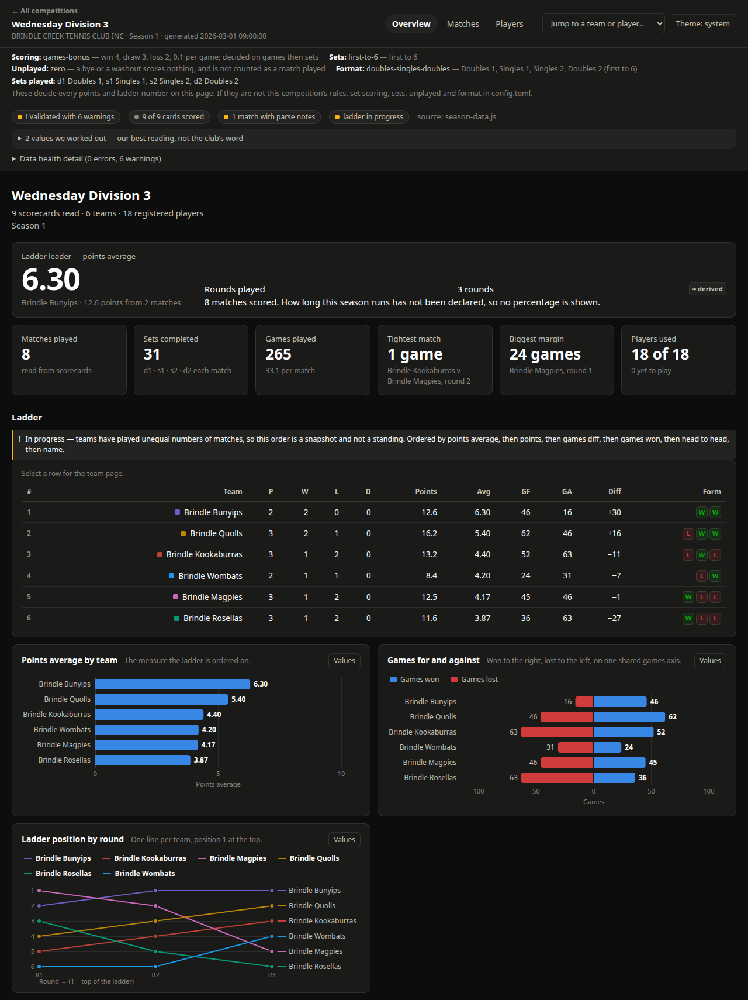
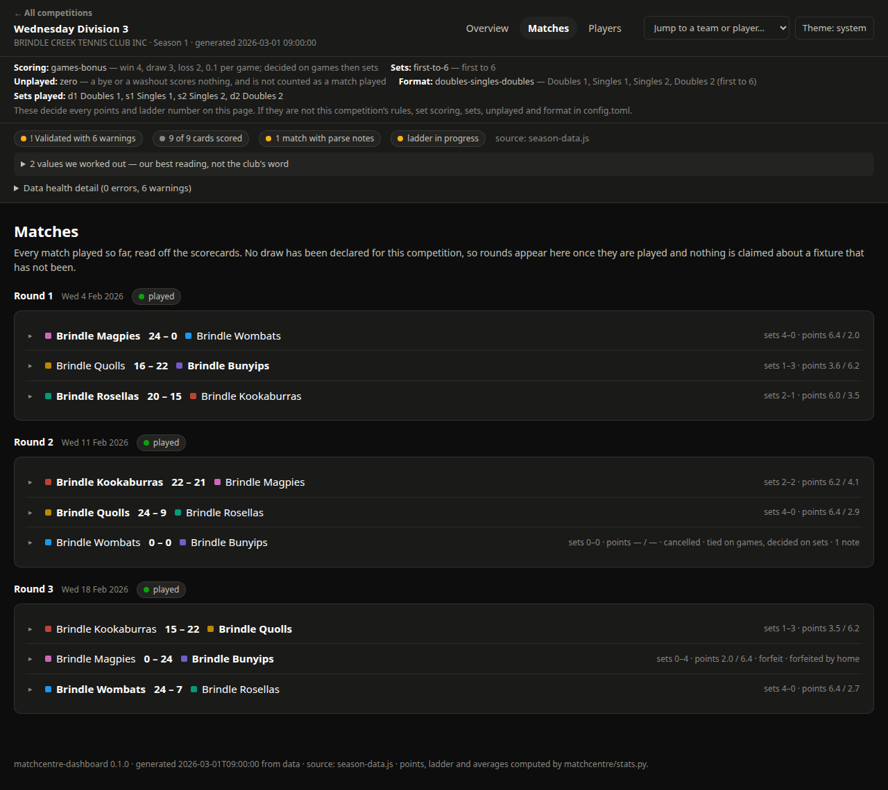
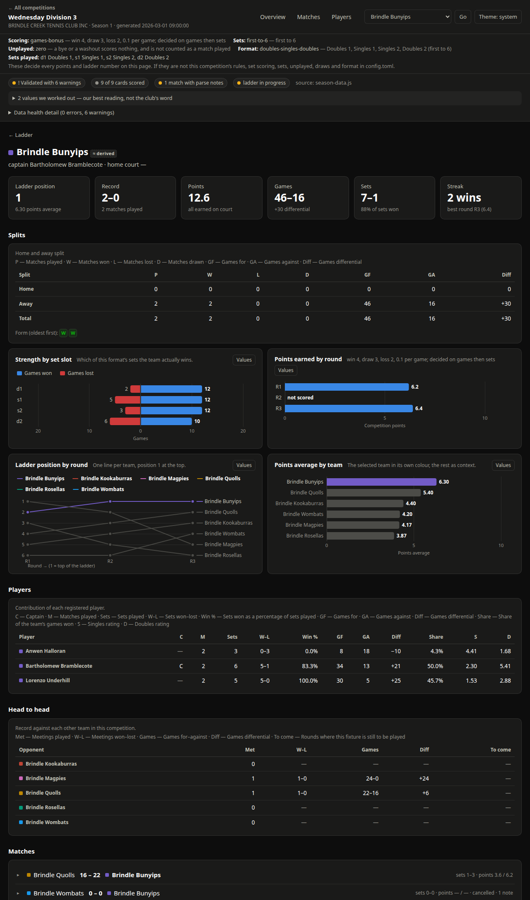
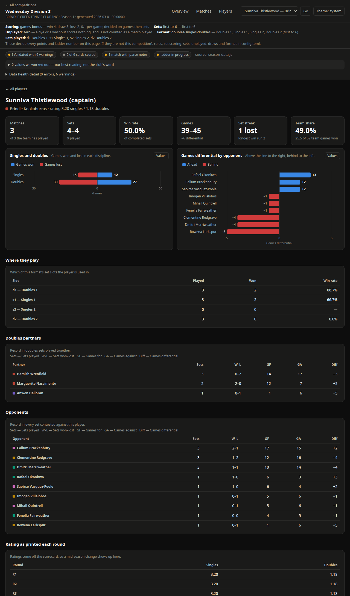
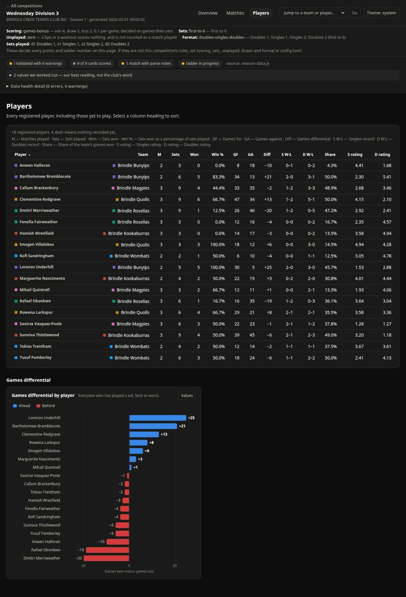

# matchcentre-dashboard

Turn a folder of match scorecards into a season dashboard your club can read.

The scorecards have to be the PDF ones exported from
**<https://matchcentre.tennis.com.au>**. That is the one supported source, and it
is the reason this tool exists. Match Centre already holds every set score of
every match your club plays, one A4 page per match, and it will hand you those
pages as PDFs. What it will not do is add them up into a ladder, a per-team page
and a per-player page. This does that.

You copy the PDFs into `data/`, run one command, and open the page it writes.

```
data/                      python3 build.py            site/index.html
  round-1/*.pdf     ->     (reads every card)     ->   ladder, teams,
  round-2/*.pdf                                        players, matches
```

Nothing is typed in twice. Every score, date, round, division, team name, player
name and rating comes off the cards themselves.



---

## Quick start

```bash
python3 tools/demo.py     # invents a fictional club's season of scorecards
python3 build.py          # reads them, writes site/
```

Open `site/index.html`. That is the tool working, on made-up data, in two
commands and about ten seconds.

Then delete `data/demo-season/`, put your own PDFs in `data/`, run
`python3 build.py` again, and read what it printed. The rest of this file is
detail: [where the PDFs come from](#getting-the-pdfs-out-of-match-centre),
[how to name the folders](#where-to-put-them), and — the one thing you do have to
tell it — [which scoring scheme your competition
uses](#scoring-presets-and-picking-yours).

---

## Contents

- [Quick start](#quick-start)
- [What you get](#what-you-get)
- [What it looks like](#what-it-looks-like)
- [What you need](#what-you-need)
- [See it work before you have any cards](#see-it-work-before-you-have-any-cards)
- [Getting the PDFs out of Match Centre](#getting-the-pdfs-out-of-match-centre)
- [Where to put them](#where-to-put-them)
- [The one command](#the-one-command)
- [Reviewing config.toml](#reviewing-configtoml)
- [Scoring presets, and picking yours](#scoring-presets-and-picking-yours)
- [Byes, washouts and rounds nobody played](#byes-washouts-and-rounds-nobody-played)
- [Checking against your association's sheet](#checking-against-your-associations-sheet)
- [Several seasons](#several-seasons)
- [Sending somebody the dashboard](#sending-somebody-the-dashboard)
- [Running it on a schedule](#running-it-on-a-schedule)
- [Publishing without names](#publishing-without-names)
- [Why it asks you to confirm the team list](#why-it-asks-you-to-confirm-the-team-list)
- [Why it refuses a card instead of guessing](#why-it-refuses-a-card-instead-of-guessing)
- [Troubleshooting](#troubleshooting)
- [All the commands](#all-the-commands)
- [Collecting cards from an index](#collecting-cards-from-an-index)
- [Checking the tool itself](#checking-the-tool-itself)
- [Reporting a problem](#reporting-a-problem)
- [Versions and upgrading](#versions-and-upgrading)
- [How it works, briefly](#how-it-works-briefly)
- [Licence](#licence)

---

## What you get

One dashboard per competition, written into `site/`, plus a front page that lists
them. It is plain HTML, CSS and JavaScript in a folder. Double-click
`site/index.html` and it opens. There is no web server, no login, and no internet
connection involved at any point.

The front page lists a competition you have declared in `config.toml` but not played
yet, too — greyed, not a link, reading **No results yet**. A competition missing from
that page and one whose first night has not happened look the same from outside, and
only one of them is worth waiting for. The card turns into a link on the run that
reads its first card.

If the section declares its draw with dates, the card gives the first round that has
one, in round order: **2 teams · round 1 on 6 Oct 2026 · declared in config.toml**.
That is the draw's date, not a countdown, and it reads the same after that night as
before it. Nothing on the front page decides from the calendar that a round has been
played, so a date gone by above *No results yet* is a round whose cards have not been
read, not one the page has moved past — and the year is there so that last season's
draw, left in, does not read as a fortnight away.

A competition with results reads like **4 teams · 6 cards · generated 10 Sep**.
That date is the build that last changed what its dashboard holds, the date the
dashboard's own header and footer give, and not the night of its last card: a
rebuild with nothing new keeps it, so it is not tonight's run either.

Each competition's dashboard is built from that competition's own cards and shows:

- **the ladder** — played, won, lost, drawn, points, points average, games for and
  against, and each team's position;
- **each team** — home and away split, recent form and current streak, its record
  in each rubber of the match (first doubles, second singles, and so on), and its
  head-to-head record against every other team;
- **each player** — sets and games won and lost, singles and doubles separately,
  win percentage, the rating printed on the cards and how that rating moved
  through the season, and which matches they filled in for another team;
- **every match** — the full set scores, who played in each rubber, the court, the
  date, and any forfeit, retirement, cancellation or dispute the card recorded;
- **the rules in force** — which scoring scheme, which set length and which match
  shape produced these numbers, stated on the page rather than buried in a file;
- **anything the tool had to guess**, marked as a guess;
- **any fixture your draw lists that no scorecard has arrived for** — if you typed
  your draw into `config.toml`. Its row says *no card yet* rather than "scheduled",
  and the report names it, once the season has moved past that round.

Beside each dashboard it writes `season.json`, the same numbers as plain data, in
case you want to do something else with them.

Each competition folder is self-contained. You can zip one and email it, and it
opens on a machine that has never heard of this tool.

Any page of it prints, for the noticeboard. A printed sheet carries the club, the
competition and the season across the top, drops the tabs and buttons, and fits
every column of every table on the paper. Sheet four says whose season it is as
plainly as sheet one: the browser's own header repeats the page, the competition,
the club and the season along the top of every sheet, so no page of a printout is
an anonymous table of numbers. (That header is the **Headers and footers** box in
the print dialog, ticked by default. Untick it and only the first sheet is
named.) Match cards print as you left them: the ones you opened bring their set
scores with them, the ones you did not print as their one-line result. Open a
night before you print it and you get that night's sets; leave them closed and
the matches page is a five-page list rather than a thirty-page one.

Where the **Data health detail** lists both errors and warnings, three radio
buttons above the list choose what it shows: **Both**, the errors or the warnings,
each counted in the words of the line above them (**3 errors and 1 card not
scored**, **8 warnings**). A choice hides the other kind and changes no count. The
page opens on **Both** every time and remembers nothing, so a choice made last
week never hides this week's error. An open list prints whole, whatever you chose;
a closed one prints its one line, as a closed match card does. A list of one kind
has nothing to choose between, and shows no buttons.

Every table has **Copy** and **CSV** beside its caption, for the committee minute
or the spreadsheet somebody keeps. Copy puts the table on the clipboard ready to
paste; CSV downloads it as a file named after the competition and the table, like
`wednesday-division-3-ladder.csv`. You get the columns you are looking at, in the
order you sorted them, so a ladder sorted by games won arrives sorted by games
won. Nothing needs to be installed and nothing leaves the machine — the file is
built in the browser from the page in front of you.

The set scores inside the match cards have no buttons of their own. They are all
in one table at the top of the matches page instead, behind **All 60 rubbers in
one table** on the demo season: every rubber with its date, round, match id and
teams in front, and after it who won and what became of the night. That is the
one to take for who played which rubber all season. The ladder's Form column
arrives one result to a word, `L W W W W`, so a spreadsheet can split it. With
several seasons kept side by side, each file's name carries the season too, so
two seasons' ladders do not download under one name.

Every match also has a page of its own, so you can send somebody one night rather
than the whole dashboard. Open a card and the last line in it is **This match on
its own page**; the address you land on ends in the match id from the scorecard,
like `#/match/4200003`, which means it still points at the same night after you
add next week's round and rebuild. That page names both teams and links their
seasons, says which round and which id it is, and leads back to the matches list.

### Every player this season, on one page

Each dashboard's Players view lists one competition's players. To see the whole
club's, the front page links **Players this season**, `site/careers.html`, after
the last competition. It lists everyone your cards name, in every competition you
have cards for and not only your club's, by name: one row for each competition
they appeared in, with the team whose roster they are on there, and a total at the
bottom. So somebody entered in a Monday and a Tuesday division, or who filled in
for another team, has their season on one page, and every player's page links
their entry, under **Season across competitions →**.

Every total is the sum of the rows above it, and every row opens that
competition's page for them, so any figure there can be checked against the
competition it came from. Win rate is worked out again from the added-up sets,
never averaged. Ratings, streaks, partners, opponents and share of the team's
games are not added up: each belongs to one competition, and each row's link goes
to them. The list is in name order and is not a ranking: Division 1 and Division
4 are not the same tennis, so a total across them says how much somebody played,
not how well.

A player is matched across competitions by the name their pages use, after
`[aliases]` and `[namesakes]`. That is one step further than a competition's own
pages go, so two people who share a name are one entry until a `[namesakes]` line
naming one team of each gives each an entry of their own (see
[Two different people share a name](#two-different-people-share-a-name-and-the-dashboard-has-them-as-one-player)).

The run's report says how many people that is, in the `cards` section:

```
  careers      2 of 11 player(s) played in more than one competition
```

It is the page [Careers across seasons](#careers-across-seasons) describes, under
the same name: switch to multi-season mode and it adds up seasons too, and every
link to it keeps working. A build that withholds players' names writes no such
page and no link to it (see [Publishing without names](#publishing-without-names)):
a withheld label belongs to one competition, not to a person, so one label can
be two people across divisions. A one-file dashboard has no link to it either,
since the page does not travel with it.

---

## What it looks like

Every picture below is a real dashboard built by the two commands in the [quick
start](#quick-start) — but from a season nobody played. `tools/demo.py` invents the
club, the six teams, the eighteen players and their scorecards, so no real person
is on this page. Yours will look like this with your club's names in it.

**Every match, with its set scores and anything unusual the card recorded.**



**One team: its home and away split, its recent form, its record in each rubber,
and its head-to-head against every other side.**



**One player: sets and games, singles and doubles apart, and how the rating printed
on the cards moved through the season.**



**Everyone who played, sortable, with the players the tool is unsure about called
out rather than quietly merged.**



The `demo` workflow builds the same season and publishes it to GitHub Pages, so a
fork with Pages switched on has a live copy to click around in. Turn it on under
**Settings → Pages → Source → GitHub Actions**; the address is then the one that
workflow prints in its own summary.

---

## What you need

**Python 3.11 or newer.** That is the whole list.

- No `pip install`. Nothing is downloaded. The tool uses only what comes with
  Python.
- No build step, no compiler, no Node, no database.
- No web server. The dashboard is opened as a file.
- No internet access, once you have the PDFs.

Check your version:

```bash
python3 --version
```

If that says 3.10 or lower, install a newer Python and run `python3.11 build.py`
instead of `python3 build.py`. The tool checks the version itself on startup and
tells you plainly if it is too old, rather than failing with something cryptic.

macOS and Linux ship Python. On Windows, install it from python.org and use
`py build.py`.

---

## See it work before you have any cards

There is a generator that writes a fictional club's season of scorecards, so you
can watch the whole thing run before you go hunting for PDFs. No real club, no
real person.

```bash
python3 tools/demo.py               # writes fake cards into data/demo-season/
python3 build.py                    # builds a dashboard from them
```

Then open `site/index.html`.

When you are done, delete `data/demo-season/` and your own cards are all that is
left. Do that before you build for real: a fictional division sitting in `data/`
becomes a fictional dashboard sitting next to your real one.

Deleting the cards does not delete the dashboard they already built. The first build
of your own cards lists it under `left behind`, and `python3 build.py --prune` clears
it; with no cards of your own yet, a build builds nothing and lists nothing, so delete
`site/` too. See [It says a dashboard was left behind](#it-says-a-dashboard-was-left-behind).

If you had no `config.toml` before the demo, its build wrote one from the demo's cards,
which goes on putting the demo's division on the front page, with no results: delete
it too, and the next build writes a fresh one.

One page needs more than one season to show what it is for: `site/careers.html`,
which follows each player from season to season (see
[Careers across seasons](#careers-across-seasons)). A build of one season writes it
too, as that season's players across its competitions, which for the demo's one
division is its Players view again. To see it across seasons, the demo writes two
seasons of the same club, with one player leaving between them and one joining:

```bash
python3 tools/demo.py --seasons multi   # writes two fake seasons into demo-seasons/
python3 build.py --data demo-seasons --config demo-seasons.toml
```

Then open `site/careers.html`. The seasons are in `demo-seasons/`, a folder each,
beside `build.py` and not in `data/`, and `demo-seasons.toml` is the config that
has the build read each folder as a season. Your own `config.toml` is not touched.
Delete `demo-seasons/` and `demo-seasons.toml` when you are done. What they built
stays in `site/` until the first build of your own cards lists it under
`left behind`, for `--prune` to clear; with no cards of your own yet, delete
`site/` too. `--out` puts the seasons in another folder of their own, and the
demo prints the line that builds them from there. It refuses `data/`, anything
inside or around it, and a folder holding cards it did not write, because that
line builds all of the folder without your `config.toml`, and would publish a
name it withholds.

---

## Getting the PDFs out of Match Centre

Match Centre prints a scorecard for a match, as a PDF: one A4 page, your club
letterhead at the top left, the date and court at the top right, the two team
names across the middle with `DEFEATS` or `LOSES TO` between them, one row per
set, a `TOTAL` row, and a signature block with both teams' player lists at the
bottom. That page is what this tool reads.

**A note on wording.** This tool was written on a machine with no internet
access, so the exact labels on Match Centre's own menus could not be checked, and
they change. So this README will not quote you a menu path it cannot stand behind.
What you are looking for is:

> the option that prints or downloads a **match scorecard** — one A4 page per
> match, with your club letterhead, the set rows and the signature block.

It is usually reached from a fixture or a result, not from the ladder. Depending
on your association's setup it may be described as printing, downloading,
exporting or viewing the scorecard, and it may open the PDF in a new tab for you
to save. Any of those is fine. If your browser opens it rather than saving it,
use its own print-to-PDF or download option to put the file on disk.

Some associations expose the scorecard to team captains and club administrators
only. If you cannot find it at all, ask whoever administers your club's Match
Centre account.

**You have the right file when all of these are true:**

- it ends in `.pdf` and is small — a few tens of kilobytes, not megabytes;
- opening it shows **one match** — not a draw, not a ladder, not a list of
  fixtures;
- your club's name is at the top;
- there is one row per set, with a games score on each side;
- there is a `TOTAL` row under the set rows;
- there are small tick boxes labelled `Match Winner`, `Forfeit`, `Retired`;
- both teams' players are listed at the bottom with their ratings.

**Check one before you fetch fifty.** There is a checker in the box. Point it at
a single saved card:

```bash
python3 tools/doctor.py "path/to/that/card.pdf"
```

It prints what the file is and what it found on the page, and finishes with a
plain verdict. The last lines you want to see look like this:

```
    verdict
      This page reads as a scorecard.
        division      3
        round         1
        date          2026-02-04 Wednesday
        home          BRINDLE ROSELLAS
        away          BRINDLE KOOKABURRAS
        verb          DEFEATS
        sets          4 row(s): 6-2, 6-4, 6-3, 6-3
        format        dssd
        totals row    present
        winner tick   home
        cross-checks  3 available, 0 disagreeing
          totals        agrees  printed games 24-12 match the 4 set rows, and
                        sets 4-0 are within the 4-0 they allow
          verb          agrees  'DEFEATS' agrees with the set rows
          winner-tick   agrees  the home Match Winner tick agrees with the set
                        rows
```

(That is a real run, against one of the fictional cards `tools/demo.py` writes; see
[See it work before you have any cards](#see-it-work-before-you-have-any-cards).)

If that reads back your real teams and your real set scores, the export you chose
is the right one and you can go and collect the rest. If it does not, a different
export is more likely the answer than a change to your process — and the checker
will have said which part of the page it could not find.

One page per file is the normal case. A PDF holding several scorecards, one per
page, is read as well; every page is treated as its own match.

---

## Where to put them

Anywhere under `data/`. The folder is searched all the way down, and **nothing at
all is read from a file name or a folder name**. A card's division, round, date,
day of the week, court, teams, players and scores all come from inside the PDF.

So the layout is for your convenience, not the tool's. Any of these work:

```
data/                          data/                       data/
  round-1/                       tuesday-c/                  everything/
    falcons-v-herons.pdf           r1-1.pdf                    scan001.pdf
    currawongs-v-ibis.pdf          r1-2.pdf                    scan002.pdf
  round-2/                       thursday-a/                   ...
    ...                            r1-1.pdf
```

You can drop a Wednesday Division 3 card and a Saturday Division A card into the
same folder and both land in the right dashboard. Rename files however suits you.
`.pdf` and `.PDF` are both found.

There is one exception, and it is opt-in: if you turn on multi-season mode, the
**first** folder level under `data/` is taken as the season name. See
[Several seasons](#several-seasons).

**Keep only match scorecards under `data/`.** Your association's draw PDF, rules
PDF and team-list PDF are not scorecards, and a PDF under `data/` that cannot be
read as one is reported and makes the run finish with an error. That is
deliberate: a scorecard that quietly disappears is the most expensive thing that
can go wrong here, because the ladder still looks perfectly reasonable and a team
is simply short a match. Keep the other documents in a folder of their own,
outside `data/`.

---

## The one command

```bash
python3 build.py
```

That is it. It reads every card under `data/`, writes the dashboards into `site/`,
and prints a report. On the very first run — when there is no `config.toml` yet —
it also writes one for you, filled in from what your cards turned out to say, and
then builds the dashboard anyway. You never have to configure anything before
seeing whether the thing works.

The report starts with the rules it used:

```
== rules in force ============================================================
  scoring      games-bonus             win 4, draw 3, loss 2, 0.1 per game; a
                                       match forfeited whole pays the side
                                       that turned up a win with every rubber
                                       a love set, and the side that gave it
                                       up 0; decided on games then sets
  sets         first-to-6              first to 6
  unplayed     zero                    a bye or a washout is scored as
                                       nothing, and not counted as a match
                                       played
  format       read from each card     the row bands and marker column of
                                       every card
```

Read those lines. They are the settings that decide who is top of the ladder, and
they are the ones no scorecard can tell us. If they are not your competition, see
[Scoring presets](#scoring-presets-and-picking-yours) — and, for the `unplayed`
line, [Byes, washouts and rounds nobody
played](#byes-washouts-and-rounds-nobody-played).

Then what it found:

```
== cards =====================================================================
  source       data
  pages seen   15
  scored       15
  refused      0
  competitions 1
  seasons      single (every card is one season)
  careers      one competition so far; totals add up from the second
```

`pages seen` and `scored` should be the same number, and `refused` should be zero.
A `not opened` line under them is a folder of cards the build could not open: see
[A folder under data/ was not opened](#a-folder-under-data-was-not-opened).
Then one block per competition, with the ladder printed in the terminal so you can
sanity-check it against the one your association publishes:

```
== wednesday-division-3 ======================================================
  name         Wednesday Division 3
  rules        games-bonus / first-to-6 / doubles-singles-doubles
  cards        15 across rounds 1, 2, 3, 4 and 5
  teams        6 (derived)
  rounds       5 played; season length not declared, so no percentage is shown
  draw         cards (card)
  ladder       in progress: teams have played unequal numbers of matches

    #  team                  P  W  L  D     pts    avg      games
    1  Brindle Bunyips       5  4  1  0    29.1   5.82   111-70
    2  Brindle Quolls        5  3  2  0    25.6   5.12    96-88
    3  Brindle Wombats       5  3  2  0    24.8   4.96    88-83
    4  Brindle Rosellas      4  2  2  0    18.6   4.65    66-73
    5  Brindle Kookaburras   5  1  4  0    19.4   3.88    74-109
    6  Brindle Magpies       4  1  3  0    13.8   3.45    58-70
  problems     0 error(s), 5 warning(s) -- see below
```

Two teams show `4` in the `P` column and the rest show `5`, because the demo's
round 5 includes a match called off — which is what the `in progress` note is
saying. That is the `unplayed = zero` line above doing its job: a match nobody
played adds nothing to either team, and is not counted for either. The ladder is
ordered on `avg`, points per match counted, which is fair across an unequal `P`,
so the order stands and the Bunyips are named the leader all the same. The note
goes once every team has the same number counted, as it will when that match is
played and its card copied in.

Then a review list of everything it worked out rather than being told, each with
the exact lines to paste into `config.toml` if you want to confirm it. Then any
problems. Then the last word:

```
== result ====================================================================
  wrote        10 file(s) under site
  open         site/index.html  (double-click works; no web server needed)
  exit 0: all 15 card(s) scored, no errors
```

`exit 0` with no errors is the pass condition. Anything else is explained in the
report above it, in the section named for the thing that went wrong.

Adding next week's round is the same command again. Copy the new cards in, run
`python3 build.py`, and the dashboard is rebuilt from scratch from everything in
`data/`. Nothing accumulates, so there is no state to get out of step and no way
to double-count a card you copied in twice under two names — that is reported as a
duplicate, naming both files.

Rebuilt from scratch, but written sparingly: a file already holding what the run
would put there is left alone, and the last line says which ones that was.

```
  wrote        5 of 10 file(s) under site; the other 5 already held what this
               run would write.
```

```
  wrote        nothing: all 10 file(s) under site already held what this run
               would write, so the dashboard still shows 24 Sep, 7:30am -- the
               build its figures come from.
```

So the date at the foot of every page, and beside every competition on the front
page, is when *its figures* last changed — not when you last ran the command. A run
that adds a card to one competition leaves the other competitions' files, and their
dates, exactly as they were. That is what makes `site/` safe to keep in a folder
that syncs, or to publish from a repository, without a week of untouched pages
turning up as changed every time you rebuild.

And it says what it changed. A run that finds a dashboard already there compares it
against the one it is about to write, and lists the fixtures that arrived, the
figures that moved, the fixtures that have gone and the teams that changed places:

```
== since the last build ======================================================
  wednesday-division-3
      new      R5 Brindle Bunyips v Brindle Kookaburras, sets 4-0, games 24-14
      new      R5 Brindle Magpies v Brindle Rosellas, sets 2-0, games 12-5
      new      R5 Brindle Quolls v Brindle Wombats, sets 0-4, games 14-24
      ladder   Brindle Wombats 4th -> 3rd
      ladder   Brindle Rosellas 3rd -> 4th
```

That is the demo's round 5 copied in and built: three cards, and what they did to
the table. A fixture whose score was corrected and exported again is listed as
`changed`, with the figures it had beside the figures it has, so you can see that
what moved is what you meant to move. `python3 build.py --check` prints the same
list under `changes a build would make` and writes nothing at all — which is how to
see what a run would do before you let it. A run refused for a name it would have
published writes no dashboard either, and heads its list the same way. A run that
could not write to `site/` may have written some dashboards before it stopped: what
it wrote is listed under `since the last build`, and the rest under `changes a build
would make`, which is what the next build lists as made.

Nothing is printed on a first build, or on a run that changed nothing. The one word
to read carefully is `gone`: see [The report says a fixture has
gone](#the-report-says-a-fixture-has-gone).

---

## Reviewing `config.toml`

The first run writes `config.toml`. You do not have to touch it. The dashboard
already works. What the file does is let you replace the tool's guesses with what
you actually know, and each guess it makes is marked as a guess on the dashboard
until you do.

Every value the tool worked out for itself is written into that file **commented
out**, with a note saying what confirming it would change. Adopting one is a
deliberate act: you delete the `#`. The season's length is the exception, since no
card prints it: you type it in first, as described below the example. Here is a
real example from a first run:

```toml
# The full list of teams in this competition, as read from the cards.
# Declaring it tells the program the list is complete, which lets it handle
# byes and flag a misspelt team instead of inventing a new one.
# Check it, then remove the # from every line of it to use it.
# teams = [
#     "Brindle Bunyips", "Brindle Kookaburras", "Brindle Magpies",
#     "Brindle Quolls", "Brindle Rosellas", "Brindle Wombats",
# ]
```

Read the list. If it is your six teams, delete the `#` from every line of it —
four lines above, the closing `]` included, since a list of six names does not
fit on one; a grade small enough to fit is written on one line, and the note
above it says "remove the # from" rather than "from every line of". Leave one
`#` behind and the file will not load: the next run refuses, naming the file and
the line, rather than building from half a list. Then re-run. If there is a
seventh team on the list you have never heard of, you have just found a typo on a
scorecard — see
[Why it asks you to confirm the team list](#why-it-asks-you-to-confirm-the-team-list).

The season's length is written for you to finish: `# rounds_total =`, with
nothing after the `=`. Type there the number of rounds your association's draw
gives the season, then delete the `#`. Deleted alone, the `#` leaves a line the
next run refuses as not valid TOML, naming the line, rather than a length that
declares the season over at the round it has reached. A season's name that no
card printed and no match date gave a year for is not written at all: its section
says so, and you add `season =` with the name in double quotes. The review list
says the same of each.

The four things most worth confirming, in order:

1. **`teams`** — the team list. Unlocks byes, and catches misspellings.
2. **`scoring` and `sets`** under `[rules]` — how your competition awards points,
   and how long a set is. These cannot be read off a card and they move the
   ladder. The file has the program's defaults behind a `#`, and every run asks
   you to check them, naming the ones still left, until you delete it from both
   (or set both in a competition's own section).
3. **`rounds_total`** — how many rounds the season runs. Without it the dashboard
   says "4 rounds played" and shows no percentage, rather than implying the season
   is finished.
4. **`season`** — what your association calls this season, for the heading.

A fifth turns up only when your cards give a reason for it: if a match was played
and decided nothing, the review list asks how many sets a result needs in that
competition. See
[The report asks how many sets a result needs](#the-report-asks-how-many-sets-a-result-needs).

Everything else is polish: how you spell each team, captains, home courts, the
published draw, merging two spellings of one person's name into one player, and
telling two people who share a printed name apart.

How you spell each team is `[team_names]`, where the first run offers every name
it un-shouted from the cards behind a `#`. Two of those guesses most need
checking before you delete the `#`. An acronym of four letters or more is read
as a word, so ABCD is offered as `Abcd`, because ACES and NETS are words. Three
letters or fewer are kept in capitals, as RTC is, and so is a word of three
letters such as ACE or OLD, though that shows in the offer where `Abcd` looks
like a name. And a letter A before another word can be read as the word "a", so
PLAN A ROCKETS is offered as `Plan a Rockets`. Correct a guess in its line, and
the name reads your way on every page.

Home courts are offered the way captains are. Every card prints the court it was
played on, so the first run writes each team's home court under its `courts`
table with a `#` in front: the court its home cards print, or where they print
more than one, the court they print most, under a comment naming each court and on
how many cards. Where two courts are printed equally often, the comment names both
and no line is offered; a team with no home card in `data/` gets no line. Check
each against the court the team plays on and delete its `#`. The dashboard shows a
team's home court only once you have declared it: a court on a card is where that
night's match was played.

Each run's review list says where `config.toml` has every value it lists: live,
commented out, or not in it at all, read from the file as it stands, so a line you
changed behind its `#` is not the value offered. A run with no file to read, such
as `--check` before the first build, reads it as empty. A value that is not in it
says where its lines go: under the table the file has already, if it has one, and
under one table shared with any other value that needs the same one, because a
file can open each table only once. One exception is the draw read from the
cards. It is listed for you to check your association's published draw against,
and never written into the file, because declared as the cards have it the next
postponed match's card would stop the run. Type in the published draw instead;
`config.example.toml` has one worked through. The others are the two values only
you can know, whose lines are printed with nothing after the `=`: the season's
length, and a season's name no card printed and no date gave a year for. The
status of each says to type the value there as well. A value commented out over two
or more blocks of one table, each under its own `# [x]`, is said to be split,
with the line of each header, because deleting every `#` would open the table
more than once: move its lines under the same `# [x]` as any other value of that
table you adopt, or under one of those headers if there is none, before you
delete the `#`.

`config.example.toml` in this folder is a fully commented example with every
setting and its alternatives, for reference. You do not need to copy it; your own
`config.toml` is written for you and is easier to start from.

Nothing in `config.toml` can change what was played: the games and sets on court
only ever come from the cards. It supplies names, labels, the team list, the draw
and the rules, and the rules decide what a score is worth, what a rubber not
played out is scored, and whether a match has a result at all, so a wrong rule is
a wrong ladder, not just a wrong label.

### Asking for a fresh proposal

Once `config.toml` exists, no run writes to it, so what later cards offer, a team
your list lacks, a captain, a home court, reaches you a value at a time in the
review list. To see it all, set against the file as you have it, run:

```bash
python3 build.py --discover
```

It builds the dashboard as a plain run does, exits as one would, and leaves
`config.toml` exactly as it is. Beside it, it writes `config.proposed.toml`: the
file `--discover --force` would write over yours, with everything yours declares
live and what the cards offer besides behind a `#`. Nothing reads it. Its first
lines say which run wrote it, how to copy a part of it into `config.toml` or adopt
it whole, and what adopting it whole loses, the same as `--discover --force` does:
a declared draw, and any comment you added. The review section opens with what it
offers that your file lacks, each with the lines that declare it:

```
  config.proposed.toml has been written beside config.toml: the file
  --discover --force would write over config.toml, with everything config.toml
  declares kept live and what the cards offer besides behind a #. Nothing
  reads it, and config.toml is as it was. Its first lines say how to adopt it,
  and what adopting it whole loses.

  Against config.toml, it offers:

    1 team(s) the cards name that a declared list lacks, Riverside Rockets,
    with the list that adds it:
      [competitions.tuesday-division-b]
      teams = [
          "Hilltop Aces", "Bramble Finches", "Corvid Lane",
          "Riverside Rockets",
      ]

    1 captain(s) the (C) marks give where config.toml names none:
      [competitions.tuesday-division-b.captains]
      "Corvid Lane" = "Fay Kite"

    1 captain(s) the (C) marks give where config.toml names another:
      [competitions.tuesday-division-b.captains]
      # in place of "Hilltop Aces" = "Cal Moss"
      "Hilltop Aces" = "Ada Quill"

    1 home court(s) the home cards print where config.toml declares none:
      [competitions.tuesday-division-b.courts]
      "Corvid Lane" = 2

    1 home court(s) the home cards print where config.toml declares another:
      [competitions.tuesday-division-b.courts]
      # in place of "Bramble Finches" = 6
      "Bramble Finches" = 5
```

Competitions the cards reach that the file does not declare, and any other value
it does not hold at all, are counted the same way; a competition the file declares
that no card reached is said to be written back as you have it. A different
captain or court is offered, never put in for you: it is behind a `#` in the
proposal, and yours stays live there. Where the cards offer nothing new the
section says `config.proposed.toml offers nothing config.toml lacks.`

Each `--discover` writes the proposal again, so make your changes in
`config.toml`, not in it; one that holds what the run would write already is left
as it is, date and all, as the dashboard's pages are. It writes over only a file
whose first line is the one every proposal begins with,
`# matchcentre-dashboard: a proposed config, which nothing reads`, so a file of
your own by that name is left as it is, and the run stops, exit status 2, before
building anything; so does one it cannot read, and it says why. The proposal holds
every name your config does, so `.gitignore` keeps it out of a commit, as it keeps
`config.toml`. A config named with `--config` gets its proposal beside it,
named after it: `club.toml` gets `club.proposed.toml`. `--check --discover` writes
neither file: its review section says what the proposal would offer.
`--discover --force` still writes over `config.toml` itself; see
[All the commands](#all-the-commands).

---

## Scoring presets, and picking yours

No scorecard says how its competition turns sets into ladder points, so this is
the one thing you have to tell the tool. It is printed at the top of every run and
shown on the dashboard, so a club running the wrong one can see that without
reading any code.

Set it in `config.toml`:

```toml
[rules]
scoring = "games-bonus"
sets = "first-to-6"
```

**`scoring`** — how a match is worth points, and how a match is decided:

| preset | win / draw / loss | bonus | a match is decided on |
|---|---|---|---|
| `games-bonus` | 4 / 3 / 2 | 0.1 per game won | total games, then sets |
| `sets-first` | 2 / 1 / 0 | none | sets won, then games |
| `rubbers` | points are the sets you won, and a match forfeited whole pays the side that turned up every rubber | none | sets won, then games |
| `simple` | 3 / 1 / 0 | none | sets won, then games |

`games-bonus` is the default. Under it every game played counts for something, so
a narrow loss outscores a heavy one and a dead rubber still matters; the ladder is
ordered on points *average*, so a team that has played fewer matches is not
punished for it. `sets-first` is the common pennant arrangement: whoever won more
rubbers won the match. Pick the row that matches how your association's published
ladder behaves.

A match forfeited whole is written on a card three ways: the Match Forfeited box
ticked; every rubber 0-0 and ticked `Forfeit` against the absent side; or, as
Match Centre exports a walkover, `Match Cancelled` ticked beside a winner and a
TOTAL row of every rubber to that side as a love set (see [A round was called
off](#a-round-was-called-off-and-its-card-has-scores-on-it)). All three are paid
alike, what `forfeit_award` below says a forfeit is worth: by default, under
every preset, a win with every rubber a love set to the side that turned up, and
nothing to the side that gave the match up. That is 6.4 and 0 under
`games-bonus` over four rubbers of `first-to-6` (the win's 4, and 0.1 for each of
24 games), 2 and 0 under `sets-first`, 3 and 0 under `simple`, and under
`rubbers`, where nobody won a set on the night, every rubber of the match's
format, 4 and 0. Where its rows give
no result, its TOTAL row may total them, or total what the box awards: every rubber
of the format to the side that turned up, each a love set under the set rule, 4-0
and 24-0 over four rubbers of `first-to-6` or `six-game-tiebreak`. Anything else is
reported once, as `totals-mismatch`. Rows that, every set finished under the
`sets` rule below, give the side the box says forfeited more sets than the side
that turned up, and the match as the scoring decides it, are reported once, as
`forfeit-contradicted`, an error, which names a verb, tick or TOTAL row restating
the box rather than report it again. Rows with a set the rule does not finish, as
a forfeit given up part way leaves one at 3-3 or retired, and rows giving the side
that turned up as many sets or more, are not reported.

A rubber not played out is scored as Match Centre's own TOTAL row counts it. A
rubber ticked `Forfeit` against one side is a love set to the other, 6-0 under
`first-to-6`, whatever games its row prints, and a rubber of a match forfeited
whole is a love set to the side that turned up, a row with play on it too. A set
one side's `Retired` box is ticked on is the other side's, its games raised to
win it: 5-1 with the away box ticked is 6-1 to home, 4-2 with the home box is
4-6 to away, and 0-0 with the away box is 6-0. A set with both sides' `Retired`
boxes ticked is nobody's, at the games printed, and said so as
`set-retired-both`; one ticked `Incomplete` is nobody's too. Under
`forfeit_award = "as-played"` each keeps the games its row prints, and the box
still says whose set it is. The ladder's Games column, the `games-bonus` points
and the players' figures count the games so scored. A TOTAL row may total the
rows either as scored or as printed, a verb and a tick may go by either, and
`set-forfeit-contradicted`, a row ticking Forfeit against the side it shows
winning, is not said of a card whose TOTAL row counts the love set. The match
page and a player's sets say the games on court beside a rubber scored
otherwise, as "Forfeit, 2–6 on court"; a rubber nobody played is in no player's
figures nor the overview's Sets completed, and its Games played counts the games
printed.

**`forfeit_award`** and **`forfeit_points`** — what a match forfeited whole is
worth, where your association prices it otherwise:

| `forfeit_award` | the side that turned up | the side that gave it up |
|---|---|---|
| `full-games` (the default) | a win with every rubber a love set | 0 |
| `fixed` | `forfeit_points` | 0 |
| `as-played` | a win, on the games the rows print | a loss, on the same games |

```toml
[rules]
forfeit_award = "fixed"
forfeit_points = 5
```

`fixed` with no `forfeit_points` stops the run and says so, and `forfeit_points`
under any other award is reported as not read. Either may be set for one
competition under `[competitions.<id>]`, as the other rules may. The price comes
from here and never from the card: a walkover's TOTAL row says who came, not what
that is worth. Whenever a forfeit is not paid as played, the run report's scoring
line and the dashboard's rules banner say what it is paid.

**`sets`** — when a set counts as finished. This one is easy to overlook and it
matters:

| preset | a set is |
|---|---|
| `first-to-6` | first to 6 games, 5-5 decided at 6 |
| `advantage-6` | first to 6 by two, no upper limit |
| `six-game-tiebreak` | first to 6 by two, tiebreak at 6-all, so 7-6 is a set |
| `fast4` | first to 4 |
| `short-sets-4` | first to 4 by two, no upper limit |
| `pro-8` | a single set to 8 |
| `pro-8-tiebreak` | a single set to 8, tiebreak at 8-all |
| `pro-10` | a single set to 10 |

`6-3` looks the same on the page whether the set was played to 6 or to 8, which is
why the tool cannot work this out. Get it wrong and the damage is quiet in both
directions: under `first-to-6`, a FAST4 club's `4-2` reads as a set still in
progress and its ladder comes out blank; under `pro-8`, a `6-3` reads as finished
when the players were still on court.

**`draws`** — whether a night can end level at all. Every preset above says yes,
because most schemes have a points value for a draw. Plenty of associations do not:
they decide every match, on a tiebreak or a countback or a by-law. If yours is one
of them, say so:

```toml
[rules]
draws = false
```

A level card then stops being scored as a draw and starts being treated as a card
with something missing — because in a grade that decides every match, that is what
it is. The night is named in the run's report, marked **Level** on the team page
with a sentence saying why, and left out of every ladder figure: played, points,
percentage, and the head-to-head that breaks a tie. The rubbers on it still count
in every player's record, because they were played.

Leave the line out if a level night is a real outcome in your grade, whatever it is
worth. What the setting is for is the opposite case: turning a scoreline your rules
say cannot happen into something you are told about, rather than a quietly-scored
draw on a ladder with no `D` column.

The **shape** of a match — how many sets, and which of them are doubles — is a
different matter: that *is* printed on every card, in the marker column beside
each set row, so it is read off your cards and you do not need to set it.

---

## Byes, washouts and rounds nobody played

You do not have to type in your draw to get byes right. There are two questions
here and they are separate: **who had the week off**, and **what that is worth**.

A third case needs nothing from you at all: a match that *does* have a card, ticked
`Match Cancelled`. That one is read off the page and handled on its own — see [A
round was called off, and its card has scores on
it](#a-round-was-called-off-and-its-card-has-scores-on-it).

### Who had the week off

Most of the time the tool works this out. Once you have confirmed the team list —
see [Why it asks you to confirm the team
list](#why-it-asks-you-to-confirm-the-team-list) — a round whose cards account for
every team but one has found its bye, and it is credited to the right team without
you doing anything.

What it cannot see is a round that left no cards behind:

- a week nobody played at all — a long weekend, a washed-out round, a bye week for
  the whole grade;
- a round where *two or more* teams are missing, because that is far more likely
  to be a card that never got exported than two byes in one week;
- a round of a five-team grade where the missing card and the bye happen together.

For those, tell it. One line per team, in the rounds column your association
already publishes — here for a five-team grade, where somebody rests every week
and round 6 was rained off entirely:

```toml
[competitions.saturday-division-a.byes]
"Brindle Bunyips"     = [1, 6]
"Brindle Kookaburras" = [4, 6]
"Brindle Magpies"     = [5, 6]
"Brindle Quolls"      = [3, 6]
"Brindle Rosellas"    = [2, 6]
```

That is the whole job — find the `B` column on the association's sheet and copy it
down. You do not have to enter any match, any fixture or any date. Rounds are
written as they appear on the cards, so `[1, 6]` and `["SF"]` are both fine, and a
single round needs no brackets: `"Brindle Quolls" = 3`.

The whole column can go in on the first night. A round with no card of its own and
none of a later round is a round still to come, decided by the cards and never by
the date, as `card-missing` decides it: the report does not tell it as short of
cards, and its byes count for nothing until its cards arrive.

A round recorded in this table alone, with no cards for it in `data/`, is not
among the rounds played that the season's progress counts: the table says who
rests in a round, not that the round has come. A washed-out round whose
`Match Cancelled` cards are in `data/` is among them, as the association's sheet
counts it, and the Matches page heads it **not played**, or **card missing** while
a fixture of your typed-in draw has no card yet.

Anything you leave out is still worked out from the cards, exactly as before, so
there is no penalty for filling in only the weeks the tool got wrong. A team you
list that is not in `teams` stops the run and says so, because a bye is the one
thing that pays a team for playing nothing, and a misspelt name there would pay a
team that does not exist.

The first run pre-fills this section for you with every bye it worked out,
**commented out**, so you can check them against the sheet without typing them
again. Uncomment nothing and nothing changes, and uncomment every line and
nothing changes either: the section says in words how a line is typed, rather
than showing an example line that would give a team byes it never had.

### What a bye is worth

Associations disagree about this, and the disagreement is worth a line in
`config.toml`:

```toml
[rules]
unplayed = "average"
```

| `unplayed` | a bye or a washout | counted in the points average |
|---|---|---|
| `zero` | scores nothing | no |
| `average` | is credited the team's own average over the matches it did play | yes |

`zero` is the default, under every preset, because it is the convention that needs
no explaining: a round nobody played adds nothing. Averaging is the more surprising
of the two — it puts points on the board for a night off — so the line above is
what you write if your association does that. Setting it under `[rules]` applies to
every competition, and a `[competitions.<id>]` section can override it again for
one grade.

**It can change the ladder order.** `simple`, `sets-first` and `rubbers` rank on
points first, and a credited round is in the points, so a team that has rested can
pass one that played the nights it did not. `games-bonus` ranks on the average,
which crediting a team its own average cannot move, and its next key is points, so
there the order changes only between teams level on average. Under every preset it
changes the points total printed against a team that has had a week off — which
is exactly the number a club compares against its association's sheet. So if your
ladder is ordered on the average, its order is right but your totals sit *below*
the sheet's, and the teams that differ are the ones that have had a bye or a
washout, this is the first line to try.

**It does change what `Avg` divides by, and the ladder says so.** `P` counts the
matches a team's result was decided in — `W`, `L` and `D` add up to it — and a
credited round is not one of them, so under `average` the points total is divided
by more matches than `P` shows. Where that happens the ladder grows one more
column, `Counted`, between `Points` and `Avg`: points ÷ counted is the average, in
that order, left to right. Under `zero` the two figures are the same number and
the column is not there. A team's own page says it too, under its ladder position.
The run report's ladder prints the same figure as `cnt`, between `pts` and `avg`,
on the same condition, and its `ladder` line then says matches counted where it
would say played.

The average column is rounded the way a spreadsheet rounds — a half goes up — so
`6.225` prints as `6.23`, not as the `6.22` most programming languages would give
you. That is deliberate, and it is why the column can be compared against a
published ladder digit for digit.

---

## Checking against your association's sheet

Most clubs hold the dashboard up against the ladder their association publishes,
every week. The build can do that check for you, and say which night a difference
is in.

Copy two columns off the sheet — each team's points and matches played — and the
last round the sheet covers into `config.toml`, under a heading naming the
competition. The first run writes that heading for each competition, with a line
for each team commented out below it: fill those in and remove their `#`, rather
than adding the heading again, which TOML refuses. In a file without it, add it at
the end. The name is the one at the top of that competition's part of the report,
and of the `[competitions.…]` section the first run wrote. For the Tuesday grade:

```toml
[competitions.tuesday-division-b.expected]
after_round = 3
"Hilltop Aces"       = { points = 10.9, played = 3 }
"Lakeside Spinners"  = { points = 15.8, played = 3 }
"Parkview Wanderers" = { points = 11.1, played = 3 }
"Riverside Rockets"  = { points = 19.0, played = 3 }
```

Each run then says how it went, in that competition's part of the report:

```
  sheet        after round 3: 4 of 4 teams compared, 1 differs -- see below
```

and a team that disagrees is a `sheet-mismatch` warning. It names both figures, how
far apart they are, and what each round gave that team — see [The report says a
team disagrees with the association's
sheet](#the-report-says-a-team-disagrees-with-the-associations-sheet).

- **`after_round` is required**, and it is what lets you type the sheet in once.
  Write it as a whole number, the last regular round the sheet covers; finals are
  not on a ladder. Only rounds up to it are compared, so the check stays right when
  later cards arrive. When a newer sheet comes out, retype the figures and move
  `after_round` with them. A sheet ahead of your cards is one `sheet-ahead`
  warning, not a disagreement for every team.
- **Type the sheet's figures, not the dashboard's.** A table copied off this
  dashboard agrees with it by definition and checks nothing.
- **Only what you type is checked.** Leave a team out, or give only its points, and
  only that is compared; the report names the teams that were not.
- **Names** are written as the dashboard prints them, or as each team's id — the
  same names the byes table takes. A line naming no team is a `sheet-team` warning,
  with the nearest name if there is one, or every name as near for you to choose.
  A team it is near that no other line names is listed among those not compared
  as `nearly named`.
- **Points are compared to as many decimal places as you typed** — `10.9` to one,
  `11` to none — rounding a half up, as the sheet does. TOML reads `10.90` as
  `10.9`, so write `"10.90"` in quotes if the second place matters.
- **Matches played agrees as either figure the ladder has for it**: its `P`, or
  its `Counted` column where that is shown, which is what the average divides by.
  An association that credits a week off may print either.
- **A missing card.** If you have typed in your draw, a team whose fixture has no
  card yet is left out of the check until the card arrives; the missing card is
  already a `card-missing` warning. Without a typed draw the program cannot tell a
  missing card from a night off, so the team is compared, and its warning says
  which round nothing was read for.
- **When the way a week off is scored explains the differences** — scored the
  other way, teams' points come right and none go wrong — you get one warning
  that counts them, and it names the line to change: `unplayed`, see [What a bye
  is worth](#what-a-bye-is-worth). A team it does not explain still gets its own.
- **Nothing on the dashboard changes because of this table.** Every figure still
  comes from the cards, and the build still succeeds. A disagreement joins the
  dashboard's data-health list, as every warning does. The first run that finds one
  rewrites that competition's page data once, and the front page's count of its
  warnings, so its "generated" date moves even though no figure did. A sheet that
  agrees leaves the page exactly as it was.
- **A difference you have looked into and accept** — a card the association scored
  differently from what it prints, say — is dealt with by deleting that team's
  line. There is no switch to silence one: the moment to stop checking a team is
  the moment you have decided which figure is right.

---

## Several seasons

By default every card in `data/` is treated as one season. If you want to keep
past seasons alongside the current one, turn on multi-season mode:

```toml
[build]
seasons = "multi"
```

**In multi-season mode, the first folder level under `data/` is the season.** That
is the one and only thing this tool ever reads from a path, and it is opt-in
precisely because it is an exception to the rule.

```
data/
  2026-winter/            <- season "2026-winter"
    round-1/*.pdf
    round-2/*.pdf
  2026-summer/            <- season "2026-summer"
    *.pdf
  2025-winter/            <- season "2025-winter"
    *.pdf
```

Everything else still comes from the cards. The folder name only says which
season; the division, the round, the date and the scores are read off the page as
always.

What changes:

- output moves to `site/<season>/<competition>/`, so five years of tennis is five
  folders rather than fifty;
- the front page gains a season picker, grouped by season and newest first;
- the site gains a careers page, `site/careers.html`, that adds each player's
  seasons up, unless the build withholds players' names;
- each season keeps its own ladder, its own teams and its own player pages.

Each season keeps its own ladder, and no ladder is ever added across seasons. What
is added up is each player's record, on one page of its own — see
[Careers across seasons](#careers-across-seasons) below.

Give each folder a readable name in `config.toml`:

```toml
[seasons]
"2026-winter" = "2026 Winter Season"
"2025-winter" = "2025 Winter Season"
```

A key is read the way the folder's name is, so capitals, spaces and punctuation
in it do not matter: `"2026-Winter"` and `"2026_winter"` label `data/2026-winter/`.
A key naming no season any card is in is reported, `--quiet` or not, with the
nearest season no line labels yet, if one is near. A season still to come is not
a mistake once it has its folder under `data/`, or a `[competitions.…]` section
names it as its `season_key`: the report only notes that the label waits for the
season's first card, or, for a section the front page lists, that for now the
label heads only that section's card.

A season with no line is named by the season its cards print, or failing that
by its folder's name made readable, `2026 Winter` of `data/2026-winter/`, and a
section no card has reached yet is named the same way. Each night on the front
page is headed by the name of its first competition, so a section no card has
reached can head a night whose cards print another name, until a line here names
them all. A competition whose own `[competitions.…]` section says `season =` is
named by that instead, which is why `--discover` writes a name this table gives
into each section commented out: an edit to the line here then renames the whole
season. A section whose own `season =` repeats the name here is still read as
naming its own season, so take that line out for an edit here to reach it.

Those two blocks are not the same setting. `seasons = "multi"` under `[build]` is
the mode: it is the line that gives each season its own ladder. `[seasons]` is a
table of labels for the picker, and it turns nothing on. So a `[seasons]` table
filled in while `[build]` still says `single` sets nothing at all — and since that
looks exactly like a season-per-folder request that was ignored, the run says so
rather than letting it sit:

```
config       [seasons] labels 2 seasons, but [build] seasons is "single", so
             every card under data/ is one season and no label is used. Set
             seasons = "multi" under [build] to give each season its own
             ladder.
```

Writing `seasons = "multi"` *inside* `[seasons]`, or at the top of the file above
any section, gets the same treatment. Both are read as what they literally are — a
season folder called `seasons`, labelled `multi` — and the run names the section the
mode belongs in instead of assuming. Nothing is silently moved for you, because a
club really can have a folder whose label is a word this tool also uses.

Name the folders so that they sort sensibly — `2026-winter`, not `winter-2026` —
and the picker will list them newest first. Two things you do not have to worry
about: numbers in a folder name count as numbers, so `season-2` and `season-10`
come out in that order with no zero-padding needed, and capitalisation is ignored,
so `2026-Winter` sits exactly where `2026-winter` would. What the order is *not*
taken from is the readable name above — a scorecard prints "Season 2" and not which
year it is, so two seasons often carry the same label, and the folder name is the
only thing that tells them apart.

One thing to know before you switch: turning multi-season mode on changes the
internal name of each competition, because the season becomes part of it. If you
have already written `[competitions.*]` sections by hand, each needs its section
name updated and a `season_key` line adding. The run tells you exactly this if it
finds a section that no longer matches anything. A file `--discover` writes in this
mode has both already: each section is named with its season and carries
`season_key`, the name of the folder under `data/` its cards are in, or their year if
they sit in `data/` itself. Capitals and spaces in it do not matter:
`season_key = "2026-Winter"` finds the cards in `data/2026-Winter/`, and `--discover`
writes it `"2026-winter"`. Keep that line if you rename the section — it is how a
card finds it.

It also changes where under `site/` each dashboard is written — `site/<season>/<competition>/`
instead of `site/<competition>/` — so the first run after the switch builds a fresh tree
and leaves every folder you had at the old depth. That run lists them under
[It says a dashboard was left behind](#it-says-a-dashboard-was-left-behind), and
`python3 build.py --prune` clears them once you are happy with the new tree.

### Careers across seasons

In multi-season mode the site has one more page, `site/careers.html`, linked from
the front page and from every player's page, unless the build withholds players'
names (see below). It lists everyone your seasons name — every player in every
grade you have cards for, not only your club's — by name, and for each of them one
row per season and grade they appeared in, with a total at the bottom. To see one
before you have two seasons of cards, `python3 tools/demo.py --seasons multi`
writes two invented ones (see
[See it work before you have any cards](#see-it-work-before-you-have-any-cards)).

Every total is the sum of the rows above it, and every row is a link to the season
page it was copied from — so any number on the careers page can be checked against
the season it came from, and from there against the cards. Win rate is worked out
again from the added-up sets, never averaged, and is a dash for anyone with no set
decided. Some things are not added up at all: ratings (each row shows the rating
printed that season), streaks, partners and opponents, and share of the team's
games. Those belong to one season, and each row's link goes to them.

The page is built from the cards under `data/` when you build, and nothing else.
Move an old season's folder out of `data/` and that season drops off the careers
page; its dashboard is then listed under "left behind" like any other.

**Who counts as one person.** A player is matched across seasons *and across
grades* by the name their season pages use, after `[aliases]` and `[namesakes]`.
That is one step further than a season's pages go — there, a name in two grades is
two players, one on each grade's dashboard — and it is the step a career needs,
because nothing on a card can say that the M Kelly of 2025 is not the M Kelly of
2026. So:

- somebody whose name was printed two ways is one career once `[aliases]` joins
  the spellings;
- two people who share a name are one career until `[namesakes]` tells them apart.
  Every row names its team and grade, so it shows. One `[namesakes]` line naming a
  team of each person gives each a career of their own, and changes nothing on the
  season pages but the player's id;
- `[namesakes]` tells people apart by team, so a player it has split keeps one
  career only while their team keeps its name.

The list is alphabetical, case and accents set aside, so Émile is among the other
Es. After Z come the names starting with a digit and then those starting with any
other letter, the order the split pages below go in. It is not a ranking: a season
in Division A and a season in Division D are not the same tennis, so a total
across them says how much somebody played, not how well.

The run's report says how many people that is, in the `cards` section:

```
  careers      12 of 38 player(s) played in more than one season
```

The careers page puts each person's seasons on one page. If you publish `site/`,
you publish that too.

The page grows with the club. Once the careers would come to more than 1.5 MB as
one page, which thirty demo seasons do at about 390 careers, `careers.html`
becomes an index of every name, each linking the page for their initial, and
each initial gets a page of its own, with the careers and their figures:
`careers-a.html` to `careers-z.html`, `careers-0-9.html` and
`careers-other.html`. An accent is set aside, so Émile is under E; a name starting
with any other letter, such as Ø, is under Other. A link to somebody's career,
from their player page too, still lands on it, opened from a folder or from a web
server. With JavaScript off it lands on their name in the index, one click away.
The report's `careers` line says what one page would have come to, and names any
page of the split still more than 1.5 MB on its own, as the largest page is at a few
thousand careers. Once a site is split it stays split, even if a season comes off
and the careers would fit again, so a link somebody saved to one of the pages
keeps working. A file of yours under `careers.html` or any of those 28 names stops
a multi-season build that prints names before anything is written, whether the
page is split yet or not. Left behind, the pages are listed as one careers page,
and `--prune` removes them together.

If you switch back from `"multi"`, a build that prints names writes the page over
the old one, as the season's players (see
[Every player this season, on one page](#every-player-this-season-on-one-page)),
and only the old dashboards are listed under "left behind". A build that withholds
names lists the old page with them, and `--prune` removes it with them.

A build that withholds players' names writes no careers page, in either mode (see
[Publishing without names](#publishing-without-names)). A withheld label
belongs to one season, not to a person: Brindle Magpies #3 this season can be
somebody else next, and a career added up by label would be two people's. The
report's `careers` line says so instead of counting anybody, and a careers page an
earlier build left with names on it is listed under "left behind" until `--prune`
removes it.

### One season at a time

Once `data/` holds a few seasons, most of the report is about seasons nobody is
playing: every archived competition gets its block, its ladder and its lines in
the review list, every run. To read only the season you are working on:

```bash
python3 build.py --only 2026-winter
```

The name is the season's folder under `data/`. Capitals and spaces do not matter,
just as they do not for the picker, so `--only 2026-Winter` is the same season.
Give `--only` twice to list two seasons.

**It shortens the report, not the run.** Every season is still read, checked and
written exactly as it would be without `--only`: `site/` comes out byte for byte
the same, the front page still lists every season, and the run takes as long as it
did. What leaves the report is the other seasons' competition blocks, ladders,
review lines, warnings and notes, and a section after the warnings says how many
there were:

```
== not listed: 2 competition(s) in 2 other season(s) =========================
  seasons      2026-summer, 2025-winter
  review       11 value(s) worked out, not declared
  warnings     8
  notes        14
  Their dashboards were written like every other, and anything in them that
  fails the run is listed above. Run without --only to list these too.
```

One review line can be about several seasons: the sets needed for a result, when
one `[rules]` number serves all of them. It is listed if any of its seasons is,
and it names every competition it is about, the listed ones first. It also says
how many of its matches are in seasons not listed, since `no-result` prints only
the listed seasons' matches. It is counted under "not listed" only if none of its
seasons is, so what is listed and what is counted add up to the run.

Three things are never left out, whichever season you name, because each is
something no later run would tell you:

- **a card that was refused, or a validation error**, in any season. They are
  what makes a run finish with an error, and the exit status is the whole run's:
  a refused card in 2019 fails a run that asked about 2026, and the report names
  the card.
- **the changes since the last build**, in any season. Each one is reported by the
  run that makes it and by no later run.
- **a dashboard left behind** anywhere under `site/`. `--prune` does not take
  `--only`: run `python3 build.py --prune` on its own, and it removes exactly what
  the report listed.

`--single-file --only 2026-winter` adds the one-file page to that season's
competitions only. A one-file page already written for another season is kept up
to date as always.

`--only` needs multi-season mode, and it is not a setting in `config.toml`: a
filter that stayed on would hide next season's report the week it starts.
`tools/scheduled.py` does not take it either, so it is only ever on a command you
type or a script of your own: if a script of yours carries `--only`, change it when
the season changes. Until you do, the "not listed" section names any other season
with a card dated later than every card in yours, and the command that lists it.
A name that is not a season is refused before anything is written, with the list
of names that are, and a season's label, a competition's id or a path such as
`data/2026-winter` is told the name to give instead:

```
error: --only 2026-wintr: not a season this run found
  The seasons this run found, newest first:
    2026-winter    2026 Winter Season
    2026-summer    Season 1
    2025-winter    2025 Winter Season
  Capitals and spaces in a name do not matter. Nothing was written.
```

A season `config.toml` names, under `[seasons]` or as a section's `season_key`,
is a season too before any card is filed in it, so a command or a script of your
own can name it the week before the first card arrives. Make its folder under
`data/` then too: a `[seasons]` line with neither a folder nor a section behind
it cannot be told from a typo, and the run reports it every time.

---

## Sending somebody the dashboard

A competition's folder under `site/` holds five files, and all five have to travel
together. Send just the page and it opens as a blank shell: the styling, the ladder
and the results were in the files beside it.

So there is a flag that writes the whole thing as one page:

```bash
python3 build.py --single-file
```

Beside each dashboard you now get one extra file, named after the folder it sits in —
`site/tuesday-division-c/tuesday-division-c.html`. That single file is the complete
dashboard: ladder, results, teams, players, the search box, the light and dark themes,
all of it. Attach it to an email, drop it in a chat, put it on a phone, open it from a
USB stick with no internet and no web server. The run prints where it is and how big it
is, so you know before you try to attach it.

It is about 360KB for a normal division's season, which is smaller than one photo.

With several divisions the run counts the files instead of naming each one, and says how
many of them it rewrote. `1 of 3 written` means the other two are exactly as the last run
left them, so a copy of either that you sent after that run is still current.

Three things worth knowing:

- **It is a snapshot.** It holds the ladder as it stood when you built it, and it does
  not update itself. Someone reading last month's copy has no way to tell, so say which
  round it goes up to when you send it.
- **You only need the flag once per folder.** Every later run keeps a folded page up to
  date whether or not you pass `--single-file` again, so a weekly script cannot leave
  the copy you have been sending people stuck on an old round. Delete the file if you
  want to stop.
- **It has no way back to the front page.** There is no site around it, so the
  "All competitions" link is not there. If you run several divisions, each gets its own
  file.

A one-file dashboard has no link to the careers page, for the same reason it has none
to the front page: neither travels with it. The careers page itself is never folded;
send the whole `site/` folder for that.

If you would rather publish the site than email it, `site/` is a plain folder of static
files and any web host serves it as it stands —
[What it looks like](#what-it-looks-like) has the note about GitHub Pages.

---

## Running it on a schedule

Once the dashboard looks right, you can stop running it by hand. Ask your
computer to run one command every fifteen minutes, and the dashboard catches up
shortly after a new scorecard lands in `data/`:

```bash
python3 tools/scheduled.py
```

It runs `build.py` for you, with three things added for a run nobody is watching:

- **It only builds when something changed.** It notes the size and time of every
  file in `data/`, of `config.toml`, of the program itself and of `site/`, and when
  none of those has moved since the last build it stops straight away, before
  reading a single card. It never picks which cards to read: when anything has
  changed, the build reads all of them, exactly as `python3 build.py` does.
- **It keeps what each build said.** Every build's whole report goes into a file
  in `reports/`, named by the date and time it ran, so the newest is last in the
  folder. The newest 30 are kept and older ones are deleted. A build that says
  exactly what the one before it said does not write a second copy.
- **It stops a build that hangs.** A build still running after ten minutes (a
  network drive that stopped answering, say) is stopped, and the front page says
  so.

### Setting it up

Let the tool write the line for you. It knows where it is and which Python is
running it:

```bash
python3 tools/scheduled.py --print-schedule
```

**On Linux or a Mac** it prints a line like this:

```
*/15 * * * * /usr/bin/python3 /opt/matchcentre-dashboard/tools/scheduled.py >/dev/null
```

Run `EDITOR=nano crontab -e`, paste the line at the end on a line of its own, and
press **Ctrl-O**, **Enter** and **Ctrl-X** to save and quit. If the computer says
`crontab` is not found, it has no cron yet: install your system's cron package
(called `cron` or `cronie`).

On a Mac, cron is not allowed into your Documents, Desktop or Downloads folders.
Keep this folder somewhere else (your home folder is fine), and the cards, the
site and the settings file too if you gave their paths, or give cron Full Disk
Access: **System Settings → Privacy & Security → Full Disk Access**, press
**+**, press **Cmd-Shift-G**, type `/usr/sbin/cron` and choose **Open**.
`--print-schedule` says so when any of them is in one of those folders.

**On Windows** it prints what to type into Task Scheduler:

```
  Program/script:  C:\Users\club\AppData\Local\Programs\Python\Python312\pythonw.exe
  Add arguments:   "C:\Users\club\matchcentre-dashboard\tools\scheduled.py"
  Start in:        leave it empty
```

Open **Task Scheduler**, choose **Create Basic Task**, give it a name, choose
**Daily**, and on the **Action** page choose **Start a program** and fill in the
boxes as printed. When it is made, open its **Properties**:

- on the **Triggers** tab, edit the trigger, tick **Repeat task every**, choose
  **15 minutes**, and set **for a duration of** to **Indefinitely**;
- on the **Settings** tab, leave **If the task is already running** at
  **Do not start a new instance**;
- on the **Conditions** tab, untick **Start the task only if the computer is on
  AC power**, or a laptop on battery skips every run;
- on the **General** tab, if the computer is often left at the sign-in screen,
  choose **Run whether user is logged on or not**. Keep `data/` and `site/` on the
  computer's own disk in that case: a drive letter you mapped yourself is not
  there for a task run that way.

It is `pythonw.exe` rather than `python.exe` so that no window flashes up every
fifteen minutes.

It does not matter which folder the scheduler starts in. This is the one thing
`tools/scheduled.py` does differently from `build.py`: a relative path you give it,
and the `data/`, `site/`, `config.toml` and `reports/` it uses when you give none,
are all taken from the project folder, not from wherever the scheduler happens
to start (Task Scheduler starts in `C:\Windows\System32`, cron in your home
folder). If you use `--data`, `--out` or `--config`, give them to
`--print-schedule` as well and they come out in the line it prints.

It gives `build.py` the folders and the settings file and nothing else. It refuses
`--players` and `--only`, which are for a run you type yourself, because a setting
kept in the scheduler's line is one nobody sees in `config.toml`. So a scheduled
copy without names needs `[build] players` in the settings file it builds with.
To keep your own dashboard named and schedule a public copy beside it, copy
`config.toml` to `public.toml`, set `players = "numbered"` under `[build]` in the
copy, and schedule a second line for it, with reports of its own:

```bash
python3 tools/scheduled.py --out public --config public.toml --reports reports-public --print-schedule
```

Given the one `reports/` folder, the two lines would find each other's record
there and build on every run. Nothing copies a change you make to `config.toml`
into `public.toml`, so one meant for both copies has to be made in both.
`public/`, `public.toml` and `reports-public/` are in `.gitignore`, as `site/`,
`config.toml` and `reports/` are.

Do not schedule it more often than every fifteen minutes: a build is stopped
after ten (`--timeout` changes that), so one run is always over before the next
begins.

### Checking it is running

Run the command yourself. It prints one line, saying what it built and where the
report is, or that nothing has changed:

```
built because the scorecard folder changed: exit 0, report /opt/matchcentre-dashboard/reports/2026-09-24_040002.txt
nothing has changed since the build at 24 Sep, 4:00am: exit 0, report /opt/matchcentre-dashboard/reports/2026-09-24_040002.txt
```

The scheduler keeps its own record of every run: Task Scheduler shows the task's
**Last Run Time** and **Last Run Result**, and on Linux `grep CRON /var/log/syslog`
(or `journalctl -u cron`) lists them. A quiet week leaves `reports/` exactly as it
was, because a run that finds nothing new writes nothing at all.

Its exit status is `build.py`'s, but for the one case below: 0 is a clean build,
1 a build with problems to look at, 2 a build that could not run. A run that
found nothing new exits with the status of the build it skipped, so a scheduler
that alerts on a non-zero result keeps alerting until the problem is fixed, not
only on the night it appeared.

When a build prints players' names in a dashboard that withheld them before it
(a copy built by hand with `--players`, say, then scheduled with a settings file
that has no `[build] players` line), the line ends by saying where: `; players'
names are back in /opt/matchcentre-dashboard/public/tuesday-division-b, which
withheld them until this run`. That run exits 1 however clean the build was (2
if it could not run), and prints its line on stderr, which the cron line's
`>/dev/null` does not throw away, so cron mails it; Task Scheduler shows the 1
as the task's **Last Run Result**. Each run that finds nothing new after it exits
1 too, and says it again, ending `until that build`, so cron mails every run
until the next build. That build, when a card lands or a setting changes, finds
no dashboard withholding names, and its status is the build's alone. If the
names are not meant to be there, add a `[build] players` line to the settings
file that schedule is given, and the next run builds; if they are, delete the
`last-run.json` in that schedule's reports folder (`reports-public/` for the
public copy above), and the next run builds without waiting for a card.

To make the next run build whatever it thinks, delete `reports/last-run.json`.
Running `python3 build.py` yourself always reads every card, schedule or not.

### What is in `reports/`

The reports, and `last-run.json`, which records what the last build saw. None
of it is needed: delete the whole folder and the next run simply builds. It is
not part of the dashboard and must never be published, because a report names
every player, so the tool refuses a `--reports` folder that overlaps `site/` or
`data/`. It is in `.gitignore`.

A report from a build that was stopped is mostly empty: `build.py` prints its
report when it finishes, so the line saying it was stopped is usually the only
one.

```
--reports DIR        where the reports go (default: reports/ beside build.py)
--keep N             how many reports to keep, at least 2 (default: 30)
--timeout MINUTES    stop a build that runs longer than this (default: 10)
```

### When a build fails, the front page says so

However the build was run, by hand or on a schedule, a build that could not
produce the figures leaves every dashboard exactly as the last good build wrote
it, and puts one sentence at the top of the front page, above the list of
competitions:

> The last build failed: no scorecards were found, so the figures below may be
> out of date.

The next build that works takes it away. A build that worked says nothing
there: the date at the foot of the page is when the figures last changed, and a
competition with cards that could not be read or with validation errors is
flagged on its own line, as it always has been. `--check` never touches the
sentence. It names no file or folder, because the site may be published, and
like the dashboards themselves it needs JavaScript. It is on the front page
only, so a bookmarked competition page does not show it.

---

## Publishing without names

A dashboard names every player the way their cards do. That suits a noticeboard
in your own clubhouse. It may not suit a page anybody can open: junior players,
people who asked not to be listed, or a club that has simply not asked. One line
in `config.toml` keeps the names out of every file the build writes under
`site/`, the front page included:

```toml
[build]
players = "numbered"
```

| `players =`  | what the dashboard prints                        | for example                |
|--------------|--------------------------------------------------|----------------------------|
| `"names"`    | names as the cards spell them (the default)      | Priya Halloran             |
| `"numbered"` | the player's team and a number                   | Brindle Magpies #3         |
| `"initials"` | initials, numbered where two players share them  | P.H., or P.H. 1 and P.H. 2 |

A name has an initial for each word and for each part a hyphen or another dash
joins, so Tui-Mae O'Dowell is T.M.O. and Pim Arkwright-Sole is P.A.S. An
apostrophe does not part a name: O'Dowell has one initial.

A number is counted per team, in the order that team's cards first put its
players on court: the set rows of its first card from top to bottom, then anybody
on that card's roster who played no set, then the next card. It stays with the
player on every page of the season. Somebody who plays here without a team in
this competition, filling in from another division, is `Player #1`, `Player #2`.
Numbers belong to one season: the same person can be Brindle Magpies #3 this
season and #5 next, and nothing on either dashboard links the two. A card that
arrives late for an early round can move numbers along, because the order is
worked out from the cards every time and nothing is remembered between builds.

Every page still works. The ladder, the team pages, each player's page, the
partners and opponents, the captain, the fill-in notes, the search and the CSV
downloads all use the label where they used the name. The data health strip on
every page says `names withheld`, and each player's page says what the label
means.

The careers page is the one page not written: a build that withholds players' names
writes no careers page, in either mode, and no page links to one. A career
adds up one person's seasons, and a withheld label belongs to one season, not to a
person. In single-season mode the page adds up one person's competitions, and a
label belongs to one competition, so one label can be two people across
divisions.

What is withheld is who played. What is not: the club, the teams, the dates, the
courts, the scores, and each player's ratings. In a small club a team, a rating
and a night can be enough for somebody who knows the club to work out who it
was. `numbered` gives less away than `initials`, so use `numbered` where that
matters.

To publish a copy without changing the one you use yourself, give the setting on
the command line. It applies to that run only and is never written into
`config.toml`:

```bash
python3 build.py --out public --players numbered
```

`tools/scheduled.py` does not take `--players`. To keep a copy like this one up to
date on a schedule, give it a settings file of its own, as
[Setting it up](#setting-it-up) shows.

The build checks its own work. Before anything is written, every value that can
hold a name in every competition's `season.json`, and every heading and label on
the front page, is searched for every name, spelling and id that the cards and
`config.toml` gave a player, and for every line of a squad that a card's note
says was read as a heading, as the card printed it and in the pieces a
bracket, a colon or a word with no letter in it cuts it into, ignoring case and
accents.
If one is still there, this run writes no dashboard. The one file it may change
is the front page's `build-status.js`, which then says the last build failed (see
[When a build fails, the front page says so](#when-a-build-fails-the-front-page-says-so)),
and `--check` changes not even that. The report says where, and which dashboards
already in the folder from an earlier build still print names. A team, a
competition or a title named after a player is the usual reason; rename it in
`config.toml`. A config file with a player's name in its own name is refused too:
rename the file, and give its new name to `--config`.
Where the report says the name is in a line under a squad on a
card that was read as a heading, the line may be a heading of your own, such as
`Mixed Doubles:` on a card of a competition you labelled `Tuesday Mixed
Doubles`: nothing tells such a line from a player's name. Rename the team, the
label or the competition's id the report names, an id being the name of its
`[competitions]` section. A dashboard's folder and web address are made from
its competition's id and its season's folder under `data/`, so those two are
searched for each word of a name as well, whether a hyphen, an underscore or a
run of digits sets the word apart, unless a team's or a competition's name
prints that word anyway. Anywhere else a name is searched for whole, so a
surname on its own in a team's name is not found, which is why the report's
last line says "full name".

A misspelt or misplaced `players` line stops the build instead of being ignored,
because ignoring it would publish the names it was written to withhold. One that
asks for names, or one beside a `[build] players` that already withholds them,
is warned about, since ignoring it publishes nothing more. The setting is for
the whole site: there is no way to withhold one division and not another.

The last section of the report says so on every such run, even with `--quiet`:

```
  players      withheld (numbered): no player's full name is in any dashboard
               this run built
```

A problem listed on the dashboard's data health panel that names a player names
the label instead. Where it spells somebody in a way the build cannot pin to one
person, a surname on its own for example, the whole message is replaced with
`(withheld: it named a player)`, and the report counts those. A surname that is
also a word of a team's, the club's or a competition's name is left in a
message, because the page prints that word anyway. A card's note that quotes a
line of a squad it read as a heading is withheld whole too, whatever its words,
and so is any message holding a word of that line the page does not print, a
card's file name for example, since nothing says that line is not somebody.
Where the line is a player's name, the note names their label instead, and where
the page prints the whole line anyway, as a team's name for example, the note is
left as it is. The file name of a card that could not be read is withheld from
the page, since nobody on it was read.

The report itself still prints names in full, because it is for you and you have
the cards. It is where to look when the panel's advice names a label, and it is
not for pasting anywhere public. To share a card's problem, use
`tools/doctor.py --redact` (see [Reporting a problem](#reporting-a-problem)).
`config.toml` holds names too, because it is your own file and not part of the
site: a first run writes each team's captain into it, by name.

Two things this cannot reach. A dashboard or a careers page left under `site/`
from before you turned it on is named under `== left behind` (`it prints players'
names, and this run withholds them`), and the run exits 1 until `python3 build.py
--prune` removes it; the command as the report prints it carries your `--players`,
if you gave one. And a copy that has already left, such as a zipped folder or a
one-file page you emailed, is out of reach: turning this on does not recall it.
If a name ever does survive into a dashboard built this way, that is a security
bug; see [SECURITY.md](SECURITY.md).

---

## Why it asks you to confirm the team list

Because a team on no card of a round is resting only if it is one of the
division's teams, and only a list you have checked says which teams those are.

Say your division has six teams and plays three matches a night. One week only two
cards turn up. That leaves two teams on no card, and two teams resting in one week
is far less likely than a card nobody exported, so the report names the round and
the two teams and asks for the card, whether or not the list is confirmed. Nobody
is credited a bye.

One team on no card is the shape of a rest, and there the list is the whole
question. Say one of the three cards that week is entered as `WILLOWBANK FALCOMS v
Herons`. Read from the cards, that is a seventh team, and Falcons is on no card of
that round: it looks exactly like Falcons' week off. Guess "bye" and Falcons is
credited for a match it actually played and possibly lost; the ladder still looks
completely reasonable, and nothing warns you.

So the tool does not guess. With no confirmed team list it never credits a bye, and
a round short of cards is named with the teams it leaves off. Once you have read
the list of teams in `config.toml` and confirmed it, the list is closed — the tool
now knows all six teams — and a round with exactly one team missing can be credited
as a bye to the right team, correctly.

Confirming the list buys a second thing. A team name is matched by how it is
printed on the card. If one card is entered as `WILLOWBANK FALCOMS`, that is a
team the tool has never seen. With an open list, all it can do is add a seventh
team and mention that it looks a lot like `falcons`. With a confirmed list, an
unrecognised team stops the run and tells you which card it is on, with the
`[aliases]` line that files it under the team it nearly is. No line is offered
when no one team is nearest, or when the name is also a team of another of your
competitions, because an `[aliases]` line applies to every competition. That is
how a misspelt team gets caught in the week it happens instead of at the end of
the season.

---

## Why it refuses a card instead of guessing

Because a guess here once produced a scoreline that was exactly backwards.

The set table on a scorecard is a grid, and the tool works out where the columns
are by measuring the table's own printed rules — the thin vertical lines. That is
how it knows which games score belongs to the home team and which to the away
team. If it cannot find those lines, it has two options: fall back to where the
columns usually are, or stop.

Falling back to where the columns usually are was measured turning `6-2` into
`2-6` on a card whose layout differed. The ladder looked entirely plausible.
Nothing was flagged. The reversal was only caught because those cards happened to
print a `TOTAL` row that disagreed with it.

So now it stops. A card whose structure cannot be read is **refused**, by name,
with the reason, and the run finishes with an error rather than a quietly wrong
number. A refused card is a visible problem you can fix in five minutes. A silently
reversed one is a wrong ladder nobody notices.

The same principle applies after a card is read. A scorecard states its result
several times over: the individual set scores, the `TOTAL` row, the `DEFEATS` or
`LOSES TO` verb between the team names, and the `Match Winner` tick. The tool
checks the set scores against every one of those that the card prints. If they all
agree, the numbers are trusted. If one of them disagrees, that is an error naming
both readings, which fails the run: something on that page was misread or
misprinted, or the card counts its rows by a rule the check does not, and you
want to know which. The match is still recorded as its set rows give it under
your club's rules, or as its `Match Forfeited` box gives it if one is ticked, so
the ladder holds what they give while you look; where they give no result, the
report's warning for the match says so as well.

This is also why the report insists that every PDF under `data/` be accounted for,
and why the run finishes with an error if even one is not.

---

## Troubleshooting

**Start here.** The tool's own report names every problem it found, in a section
titled for it, with the file at fault. Read it before anything else. When a card is
refused, the report gives you the exact command to investigate it.

### A card was refused

```bash
python3 tools/doctor.py "data/round-3/that-card.pdf"
```

That prints what the file is, what the page contains, which header fields it could
find, what the reader made of it, and a plain verdict. It is deliberately more
forgiving than the builder, so "the checker found a date and a division but the
build refused the page" is itself useful information — it narrows the problem down
to one part of the page.

Common causes, in the order they are worth checking:

| The verdict says | Usually means |
|---|---|
| not a PDF | the file is a web page or an image that was saved with a `.pdf` name |
| no table rules could be found | usually it is not a scorecard — a draw, a ladder, a fixture list or the rules. If it is one, another program re-saved it and redrew its table; export it again from Match Centre |
| table rules as outlines rather than fills | another program re-saved or re-printed the card after it was exported; export it again from Match Centre |
| encrypted, or a feature this reader does not support | the PDF was re-saved or password-protected by another program; export it again from Match Centre |
| no text could be recovered | the PDF is a scan or a photo of a printout, not an export. There is no text in it to read |
| the column rules could not be read | the page layout is not one this tool can measure. Send the file, or its verdict, to whoever maintains this |
| none of this card's checkboxes is beside a label this reader knows | the card comes from another template, or was retyped, and words its tick-box labels differently or prints them away from their boxes. The detail line lists the seven labels looked for and what the page prints instead. Use Match Centre's own export of the match if there is one; if not, send the verdict to whoever maintains this |
| could not name 6 of the 30 checkboxes this card needs, or any other count | a box the card needs is not whole where this reader looks, so a tick in it would read as no tick: its square or its label was lost with part of the page, to a download that stopped early or a damaged copy, or the labels are printed a little off their boxes or on their other side. The detail line names every box it could not name, by row and side, and says what it found of it, and the doctor's verdict gives the cause that fits. Download the card again from Match Centre; if the new copy is refused the same way, send the verdict to whoever maintains this |
| this card ticks a checkbox this reader reads nothing from | every box the card needs is named, and the card draws one more that is ticked: a set's box away from the set rows, or a square no label names. Nothing is read from that box, so the tick would read as no tick. The detail line says where the box is. Export the card again from Match Centre; if that export is refused the same way, send the verdict to whoever maintains this |
| no checkboxes could be located | the tick boxes are not drawn the way Match Centre draws them, usually because another program re-saved or re-printed the card; export it again from Match Centre |

A card refused with `no readable date and no weekday printed beside one` is one
the checker says reads as a scorecard: the page is fine, and it is the filing that
cannot place it on a night. No date was read — none is printed, it is printed in a
form not listed here, or it is not a real date — and no weekday is printed beside
it. The forms read are `DD/MM/YYYY`, `DD-MM-YYYY`, `DD.MM.YYYY`, `DD/MM/YY`,
`D Month YYYY`, `D Mon YYYY` and `YYYY-MM-DD` — figures day first, and a two-digit
year as 20YY. `tools/doctor.py` says which of the three it is: its `date` header
field is `not found` when none is printed, and the reader's warning under the
verdict says whether the one found is in a form not read or not a real date. A
card whose competition line names its night (`Tuesday Night Fixtures 2026`) is
filed by that night instead, undated, and one that prints its weekday (`Tue August
18, 2026`) by that weekday otherwise; either way the reader's warning says so. Send
the file, or its verdict, to whoever maintains this.

A card's night comes first. When its competition line names one weekday in front
of `Night Fixtures`, the card is filed under that night whatever its date says: a
card of a Tuesday competition dated on a Thursday is filed under Tuesday, and its
match is shown on the date the round's other cards dated on a Tuesday agree on,
with one note naming the date it printed and the date it is shown on. A card that
prints a range of days in place of a date (`Tue 29/09 - Sun 04/10`) is dated the
day of it on the night, in the year its competition line prints; with no year
there, or with days that are no such week in that year, it is undated, and the
reader's warning says which. A line naming no weekday, or more than one, names no
night: a range of days under it is dated the day it opens, which files it, and any
other card is filed by its date as before.

The checker exits 0 when a page reads as a scorecard and 1 when it does not, so
you can loop over a folder:

```bash
find data -iname '*.pdf' -print0 |
  while IFS= read -r -d '' f; do
    python3 tools/doctor.py "$f" >/dev/null || echo "BAD $f"
  done
```

### The report says a card prints `VS` instead of a result

The match was still read, still scored and still on the ladder. Check it on the
dashboard if you like — it is there with its games, its sets and its points.

Match Centre prints `DEFEATS` or `DEF. BY` between the team names when it holds a
result for the fixture and `VS` when it does not, usually because the scores were
entered but never confirmed at the association's end. The set rows are on the card
either way, and the set rows are what this tool scores from; the banner is only one
of the three places a card repeats its own result.

What the warning tells you is which check could not run. A card printing `VS`
normally carries no `Match Winner` tick either, so its printed `TOTAL` row is left
as the only confirmation of its set rows — one is enough to trust them, and if that
one had disagreed you would have an error instead. If you would rather have all
three, export the card again once the association has finalised the result.

A match that genuinely was not played is a different line in the report:
`no-result`, which names the washout or the cancellation instead. See [A round was
called off, and its card has scores on
it](#a-round-was-called-off-and-its-card-has-scores-on-it).

### A round was called off, and its card has scores on it

The report says so under `no-result`, naming the card:

```
  no-result
      wednesday-division-3: R5 brindle-magpies v brindle-rosellas: recorded as
        cancelled, so it is not counted in the ladder.
```

That is the report telling you the card was read and then set aside, and both
halves of that matter. It knows because the card itself says so: Match Centre
prints a ticked `Match Cancelled` box on it, which is the only thing on a page that
can distinguish a night called off from a night played. A washed-out match with no
such tick reads as an ordinary one, and the fix is to mark it cancelled in Match
Centre and export the card again.

A washed-out night often stops partway. Two rubbers finish, a third is level at
5-5, the rain comes, and Match Centre keeps whatever was entered — so the card
arrives with real games on it and no result. Those games are not a partial result
to be counted at reduced strength. They belong nowhere, so nothing on the card is
counted anywhere: not a game, not a set, not an appearance, not a match played.
The two teams show one fewer in the ladder's `P` column than the teams who played
that night, and their averages are worked out over the matches they did play.
The card's roster block is set aside with the rest: a name printed only there
registers nobody, a `(C)` printed there names no captain, and the ratings beside
the names are not a round of anyone's rating history. A night not yet played is
set aside the same way, so a folder of round one before anybody has played it has
its teams and nobody on them, and no captains unless you name them under
`[competitions.<id>.captains]`. The report says so in one note, and a team's
first card that counts registers the players on its roster.

The banner between the team names is set aside too, with the winner tick and the
TOTAL row, as there is no counted result for them to agree with: a card called off
that prints `DRAWS WITH` over the rubbers finished before the rain fails nothing
by them, and `no-result` is the one finding about it. So does a card called off
that ticks a `Match Winner` box or prints a verb such as `DEFEATS`: Match Centre
exports a night the rain stopped that way, the tick and the verb naming the side
ahead when play stopped, and the `Match Cancelled` tick decides. Its one
`no-result` is still a warning, and says what else the card claims. The demo's
washout above, had Match Centre ticked home, the side ahead at 12-5, and printed
`DEFEATS`, would read:

```
  no-result
      wednesday-division-3: R5 brindle-magpies v brindle-rosellas: recorded as
        cancelled, so it is not counted in the ladder. The card also ticks
        home as Match Winner and the verb 'DEFEATS' means home won; the Match
        Cancelled tick decides.
```

There is nothing to correct: the card is what Match Centre made.

A card ticked `Match Cancelled` counts in two cases: it also ticks a `Match
Forfeited` box, and is the forfeit that box says, or it is a walkover. Match Centre
writes a match one side gave up whole as `Match Cancelled` ticked, the side that
came ticked `Match Winner` (or, with no tick, named by the verb), and a TOTAL row
of every rubber to that side as a love set and nothing to the other: 4-0 and
24-0 over four rubbers of `first-to-6`. A card printing exactly that, with no
Match Forfeited box ticked and any verb it prints naming the side that came, is
scored as a forfeit by the side that did not come, paid what `forfeit_award` says
a forfeit is worth (see [Scoring presets](#scoring-presets-and-picking-yours)),
and its verb, tick and TOTAL row are held to the walkover rather than to its
rows. Its rows may hold play its TOTAL row does not count, where the night was
given up part way, and the report says so once, as `walkover-rows-played`, a
warning. Rows that, every set finished, give the side that did not come the
match are `forfeit-contradicted`, as they are against the box. A TOTAL row that
is not that award, or no TOTAL row at all, is a washout's, however the tick
reads, and so is `VS`, `DRAWS WITH` or a word this program does not know beside
the tick.

A night not yet
played is not reported for its `VS`, but the rest of its card is still read against
its rows, since blank rows are what a misread card looks like too. One that names a
winner over them, in its banner or by a tick, is an error: a card that states a
winner and gives no games is likelier misread than unplayed. A word in its banner
this program does not know is a warning.

A card with nothing on it at all, every set row 0-0, `VS` or no verb, no tick, and
a TOTAL row of noughts or none, is told once, as `no-result`, with what to do if
the night was played after all:

```
  no-result
      tuesday-division-b: R4 lakeside-spinners v parkview-wanderers: recorded
        as unplayed, so it is not counted in the ladder. Every set row reads
        0-0: if the match was played, enter its result in Match Centre and
        export the card again.
```

Nothing on it needs confirming, so F6 says nothing of the TOTAL row and tick it
lacks, `totals-missing` nothing of its TOTAL row, and `players-unrecorded` nothing
of the name cells nobody filled in. The match's notes on the dashboard do not say a
cross-check is missing either. A card called off with nothing on it is told its
`no-result` alone, as above, since nothing needs doing. A card that ticks Match
Disputed over rows like these is told `disputed` as well, and what each empty
rubber lacks, since a disputed match was played.

This is not the same as a match that was played to the end with one rubber left
unfinished — a set abandoned at 4-4, a pair who had to leave. That match happened,
so its games, sets and appearances all count, and it takes a ladder result too as
long as enough rubbers finished (`min_sets_for_result` under `[rules]`, three of
four by default). The line between the two is not how much of the card is filled
in; it is whether the night was played at all.

Such a rubber, with no box ticked on its row, is a warning under the rule that
says what it is: `set-unfinished` for a set stopped short, `set-tied` for one
left level, `set-no-games` for a row with no games on it. A club whose play stops
at a fixed time whatever the score has one most nights, so each of the three is
one warning for the competition, listing every such rubber, with its score where
it has games, and naming the cards. A competition with only one reads as before:
`R4 riverside-rockets v hilltop-aces d2: 5-4 is not a finished set under
first-to-6 (first to 6) and is not marked forfeit, retired or incomplete, so
nobody is credited the set.`

A match that was played can still fall short of a result — fewer rubbers finished
than `min_sets_for_result`, so nobody won it. Its games, sets and appearances count
as they do for any match that happened, and the report names the card under
`no-result` with how many sets short it was. Until you have set
`min_sets_for_result` yourself, the review list asks once whether that number is
your association's. See
[The report asks how many sets a result needs](#the-report-asks-how-many-sets-a-result-needs).
On the dashboard the two teams' head-to-head counts the meeting and shows its
games; where that happens the team page grows a `No result` column beside `W–L`,
because a night counted under `Met` and in neither win column would otherwise read
as a match nobody won.

There is nothing to fix here. The one thing worth checking is that the ladder's
`P` column matches your association's sheet — if the sheet has a number there for
the washed-out night, your association pays for it, and that is the `unplayed`
line: see [What a bye is worth](#byes-washouts-and-rounds-nobody-played).

### The report asks how many sets a result needs

Two things in a report lead here: a review item headed `the sets needed for a
result in …`, and a `verb-no-result` error. Both mean a match was played and fewer
of its sets finished than `min_sets_for_result` says a result needs.

```
  the sets needed for a result in tuesday-division-b
      why: 2 played match(es) decided nothing because fewer than 3 of their
           sets finished (see no-result); 2 card(s) print a result anyway (see
           verb-no-result); 3 is a default, three quarters of the sets rounded
           up, as no card states it, so if your association counts a result on
           fewer, write its number below
      in config.toml: commented out; delete the # to adopt it
      [rules]
      min_sets_for_result = 3
```

```
  verb-no-result
      tuesday-division-b: data/Round4/RiversideRockets-HilltopAces.pdf: the
        card states a home result but only 2 of 3 sets needed for a result are
        complete.
          DEFEATS
      tuesday-division-b: data/Round5/LakesideSpinners-ParkviewWanderers.pdf:
        the card states a home result but only 2 of 3 sets needed for a result
        are complete.
          DEFEATS
```

No scorecard states that number, so until you set it the tool uses three quarters
of a match's sets, rounded up (3 of 4, 5 of 6), and asks once however many
matches it applies to: under `[rules]` when one number serves every competition,
otherwise once per competition. Each of those matches is named under `no-result`
further down the report. Under `--only` that is the listed seasons' matches, and
the question says how many it leaves out.

`verb-no-result` is an error, and the run exits 1 while it stands: Match Centre
printed a result, a winner or a draw, on a card whose sets, as this tool reads
them, do not reach one. That is the likeliest sign the number is wrong for your
grade.

Check one thing first. If the report also says a set on those cards is not
finished and is not marked retired or incomplete (`set-unfinished`), look at
`sets` under `[rules]`: a set played to 4 read as a set to 6 looks unfinished, and
the review item says so when it applies. Fix that before you touch this number.

Then it is your association's rule, and only you can look it up:

- **It counts a result on fewer sets.** Put that number in place of the 3 and run
  again. The matches then have results, and the next report lists each one under
  `since the last build`.
- **It does not.** Add the line as it stands. The reminder stops, and the matches
  stay under `no-result`, which is where an unfinished match belongs. If a
  `verb-no-result` error stays too, compare that card's set rows with what the
  dashboard shows: a set read as unfinished that the card shows finished is the
  other way to get it.

Your `config.toml` already has a `[rules]` section, so add the line inside it, or
delete the `#` in front of the `min_sets_for_result` line already there and check
that its number is the one above. A second `[rules]` heading makes the file refuse
to load. The same goes for a `[competitions.…]` heading that is already in the
file.

When the competitions in one run need different numbers (a four-set grade and a
two-set one, say), one `[rules]` line would change one of them. The item then
names `[competitions.<id>]` instead, and the number applies to that competition
alone. A number of 0, or one larger than the sets on the cards, is refused by
name.

### The report says a card prints `Unspecified player`

The warning is `players-unrecorded`, and it counts them for you: how many name cells
on the card print the placeholder, and how many of the card's rubbers those cells
are spread across. One line per card, however many cells it has. A card with
nothing else on it, every set row 0-0 and no result claimed, has no line here: its
`no-result` is the one finding about it.

`Unspecified player` is what Match Centre prints where a name has not been entered.
It is not somebody's name, so it is not read as one: no player is created, nothing
is credited to anyone, and the rubber's games still count if the match was played.
The warning exists because the alternative — dropping the cell without saying so —
looks identical to a card that had no such row at all.

What to do depends on the last clause of the message:

- **`this match was called off`** — nothing. The night never happened, the names
  were never going to be entered, and the card contributes nothing regardless.
- **`this match was forfeited whole, so nobody played those rubbers`** — nothing.
  One side gave the match up, by the Match Forfeited box or as Match Centre
  writes a walkover, so nobody was on court to name, and the match is scored as
  the forfeit it is.
- **`those rubbers have games but …`** — the match *was* played, and somebody's
  matches are missing from their record. The clause says where, side by side:
  `nobody to credit them to on the away side of rubber(s) 3` where a side's cell
  prints only the placeholder, and `only one player of the pair to credit on the
  away side of rubber(s) 1 and 4, so half of those games are credited to nobody`
  where a pair names one player above it. Where a rubber printing it was left
  0-0, the last of a night stopped early or one after a forfeit, the clause
  begins `those rubbers with games have …` and speaks of those alone. Enter the
  players in Match Centre, export that card again, replace the file in `data/`
  and re-run. The team's games and points are already right; it is the player
  pages that are short.
- **nothing after `so no name was recorded for them`** — nothing. Every rubber
  with games is credited in each of its places: a singles cell prints its player
  above the placeholder, say, or the placeholder is only on rubbers left 0-0,
  which have no games to credit. It is told because the cell is still not a name.

The detail names the side too, `3 placeholder cell(s): away in rubber(s) 1, 3, 4`.
A placeholder is reported here and nowhere else. A pair naming one player above
it is not also told `set-player-count`, nor a cell printing it alone
`set-players-missing`: those two are for a name the card leaves blank or the
reader could not read, and both still say so, beside a placeholder too: a pair
printing it in one cell and leaving the other blank is told
`set-players-missing` for the blank one. The match page shows each place nobody
filled as `not recorded`, beside the name where a pair names one, and so do the
matches page's table of every rubber and its CSV.

### The report says a card's roster was not read

The warning is `roster-missing`, one per card, and it says which side: `no home
roster was read`, or `neither roster was read`. The roster block is each team's
registered squad, printed under `Players` at the foot of the card with the players'
ratings. Without it, nothing on that card says who is registered to either team, so a
fill-in on that side cannot be told from a squad member, and nobody who played on it
has a rating for that round. The scores are not affected. Anyone in its set rows whom
no other card registers is named once more, in one `unknown-player` for that side.
A side that gave the match up whole, by the Match Forfeited box, by every rubber's
`Forfeit` box or as a walkover, is not asked for its roster when every row is 0-0,
since nobody played for it; given up after a rubber, it is.

The match's notes on the dashboard say why:

- **`nothing says where the roster block ends`** — neither a fill-ins heading
  (`Fill-ins`, `Reserves` or `Substitutes`) nor a `Comments` heading is under the
  squads, nor anything else that marks where a squad stops. That is what a
  download that died part-way through the roster block looks like, and part of a
  squad is not read as the whole of it. Export the card from Match Centre again,
  replace the file in `data/` and re-run.
- **`no 'Players' heading`** — the same, cut off before the roster block began.
- **`one side's registered squad is missing`** — the card printed one team's squad
  and not the other's. Check the card in Match Centre.

A fill-ins heading worded `Reserves` or `Substitutes`, singular or plural, alone or
with a side named, `Home Reserves` or `Substitutes (Visitors)`, ends both squads as
`Fill-ins` does, printed over one squad or both, and the card says nothing of it.
A side may be named in words too, `Home Team Fill-ins` or `Visitors Reserves`.
Those are whole words, a colon or a bracket round them aside, on a line holding
nothing a name, a comment or a rating would, so `Reserves arrived late`, a fill-in
printed as `Substitute Golf Garside` and a player named `Reserve Quill` are not
headings. Nor is `Bravos Reserves`: a team's name before the word needs the word in
brackets, `Bravos (Substitutes)`, or it reads as a heading in another word does. The
line is the whole row across both squads, so `Fill-ins` or `Reserves` over one squad
beside `Emergencies` over the other is no heading either: the two read as players, one
in each squad, and `player-two-rosters` may name them. A heading in another word,
`Emergencies` or `Substitutions`, printed over one squad only is read as a player in
that squad, and a fill-in printed under either column stays in the squad above it;
printed over both squads, it is read as below.

Such a line reads exactly like a player printed with no rating, so it is kept, and
the note says what it may be: `read 'Emergencies' on the home side as a player,
though it may be a heading printed over that squad alone`. The line it quotes is the
first with no rating under a squad's rated players that no set row names, asked
wherever the block does not end at a fill-ins heading. If it is a heading, that squad
holds it and each line under it on this card. If it is a player sitting the night out
before a rating was given, the note is the cost of asking, and a rating in Match
Centre quiets it. Over a squad that prints nobody's rating nothing sets such a line
apart, and nothing is said, whatever the other squad prints.

A line printed so close above the heading under the squads that it cannot be read
apart from the heading's own row is left out, and the note says that too: `left '…'
on the home side out of the squads, since it is printed too close above 'Fill-ins'`.
If it is a player, that squad is short on this card.

A different note means the squads were read, and says where one stopped: `read '…'
as a heading, not a player`. A squad ends at the first line under it with no rating
and a bracket, a colon or a word with no letter in it, because that is how a fill-ins
heading worded some other way reads, `Emergencies (Visitors)` or `Emergencies -
EXAMPLE ALPHAS`. If the line it quotes is a player printed unrated with a nickname in
brackets, that squad is short from them down; with a rating, or their name without
the brackets, in Match Centre, the card reads in full.

A heading printed word for word the same over both squads with none of those in it,
`Emergencies` alone, reads exactly like two people who share a name, one in each
squad. It is read as a heading when nothing else on the card settles it: the block
ends at `Comments` or the foot of the page rather than at a fill-ins heading, no
other heading ends either squad, and the line is one printed across both, under
somebody, with nobody rated from it down in either squad and no set row naming it. A
`-` or any line with no letter in it, which is what a template prints under a heading
nobody filled in, is not a heading of its own here, so it does not stop the rule. Of
several such lines the first is taken, so a placeholder or a name printed under both
copies, `None`, `Nil` or `-`, stays under it. The note then says `read 'Emergencies',
printed the same on one line across both squads, as a heading`. If the line it quotes
is two players who share a name, both unrated, level and sitting the night out at the
foot of their squads, both squads are short from them down, and anyone printed
unrated under them goes too. That is so over no heading, over `Emergencies` printed
over both squads, over a heading like it printed over one squad only or a different
one over each, and over a `-` under each. A rating in Match Centre for either of them
or for anyone under them, or a heading the rules above know printed under them,
`Fill-ins`, `Reserves` or `Emergencies (Visitors)`, reads the card in full.

With no `Comments` heading a comment is under the squads too. One holding those
words, `Reserves arrived late` or `Substitutes: 2`, reads as the same comment would
with another word in their place, and `Court reserved until nine` holds none of them.
One card still reads such a heading as a player in both squads, and
`player-two-rosters` names it as one player on two teams: a comment that reads like a
heading, `Golf Garside (substitute)`, `Reserves (none)`, `Reserves: -` or `Home
reserves`, is where the block ends.

### A team was awarded a bye it should not have had, or a round is short

Confirm the team list in `config.toml`, or the file `--config` names, as the
report's note on the list says: it says whether to remove the `#` from every line
of `teams = [...]`, to add the list, or to fill it in.
Until you do, no bye is credited at all, and the report names the short round
instead. See [Why it asks you to confirm the team
list](#why-it-asks-you-to-confirm-the-team-list).

If the list is confirmed and a bye is still on the wrong team, or a week nobody
played is missing entirely, state the byes yourself in the
`[competitions.<id>.byes]` table: a stated bye wins over a worked-out one. See
[Byes, washouts and rounds nobody
played](#byes-washouts-and-rounds-nobody-played).

A card overrules both. A team with a card in a round is credited no bye in it,
whatever the table says, and the report names the line as `bye-contradicted`.
That holds even for a card the ladder sets aside, such as one of two cards that
disagree: the team played that night, so the round is in none of its ladder
figures until the card is put right. A round of your draw that rests a team and also lists it in
a fixture credits no bye either, and nothing read says which line is right. Once
the round has cards the build fails as `bye-and-fixture`. Before then it is a
warning, because nothing is counted from that round yet. Either way the finding
says which line to take out, and where the fixture's card is missing it asks for
the card there rather than again as `card-missing`. The dashboard draws none of
these rests, and the review section does not offer them back.

### The report says no scorecard was read for a fixture

```
  card-missing
      tuesday-division-b: round 1: no scorecard was read for Lakeside Spinners
        v Parkview Wanderers, which the declared draw lists, and 1 of the 2
        fixtures the draw lists for that round do have one. Export it from
        Match Centre into this round's folder — or if the file is already
        there, run tools/doctor.py on it to see why it was not read.
          subject: R1 lakeside-spinners v parkview-wanderers
          round 1: 1 of 2 declared fixtures have a card; cards exist for round
            2
```

Your draw says the match exists and none of the cards in `data/` is it. Two things
to check, in this order:

1. **Is the file there at all?** If not, export it — see [Getting the PDFs out of
   Match Centre](#getting-the-pdfs-out-of-match-centre) — and put it in that
   round's folder.
2. **Is it there and not being read?** Run `python3 tools/doctor.py` on the file.
   It says whether the page reads as a scorecard and why not, and the top of the
   build report also lists every card it refused, by path. See [A card was
   refused](#a-card-was-refused).

Where a card of those two teams for that round was read and filed under another of
your competitions, the warning says that in place of asking for the card. It says
`no scorecard of` the fixture `was filed under this competition`, then which
competition the card was filed under, and why — the weekday it was filed by, or the
division it prints. Cards are filed by what they print, so that card counts where it
is filed and not here. If what it prints is wrong, correct the card in Match Centre
and export it again. The round's note at the top of the report says the same, with
the file the card was read from, and so does the note on a round of a draw worked
out from the cards. Where that card leaves one team of the round on no card, the
note offers that team's line in the byes table, in case it was resting, and asks
you to confirm the team list first if you have not: a byes table on its own closes
the list to the teams it names.

It is a warning, not an error: the build still succeeds, because exporting the cards
you have and building that evening is ordinary. The one that has not arrived is named
so you know it is outstanding rather than finding out in October.

**What it does not claim.** It does not say the match was not played. A forfeit, a
washout and a card nobody exported look identical from outside, and which one it was
is written on the scorecard being asked for. If the night really was called off,
the card for it usually exists with `Match Cancelled` ticked — see [A round was
called off, and its card has scores on
it](#a-round-was-called-off-and-its-card-has-scores-on-it) — and if the whole grade
had the week off, say so in the byes table.

**Only rounds the season has got past are named**, and "got past" is decided by
other cards, never by the date: a round is counted as played when it has a card of
its own, or when any later round has one — which is the round the last line of the
finding names. So a draw typed in during August does not produce a fault for every
week of the season, and a build re-run next year reports exactly what it reported on
the night. Later is the order the season runs in, whatever the dates: round 10 after
round 9, a round with some other name after the numbered ones, and the finals last,
QF, SF and PF before GF or F, in any of the spellings `config.example.toml` lists
under `finals`. A round named some other way that you set `finals = true` on runs
after the latest of those finals your draw lists above it, whether or not you set
`finals = true` on that one, and before the next; with none above it, ahead of
them all.

Two related cases are reported differently, because the fix is different:

- a card whose home and away are the other way round from your draw is
  `draw-reversed`, not a missing card. The card is right there; it is the sides that
  disagree.
- a fixture the cards contain that your draw does not list is `draw-mismatch`. That
  is usually a round that grew after you typed the draw in. A round typed in with
  the wrong pairings shows it another way: every card read for it is one of those,
  and the `card-missing` warning counts none of the draw's fixtures as having a
  card, and says `the 2 cards read for that round are all of fixtures the draw does
  not list`.

This check needs the draw. Without `[[competitions.<id>.rounds]]` blocks in
`config.toml` there is nothing to compare the cards against, and a draw worked out
from the cards cannot be short of one — its fixtures *are* the cards.

A round typed in as its cards show it is the same: the card that never came is of no
fixture it lists, so there is nothing for this warning to name. With the team list
confirmed, the round's note at the top of the report names the teams the round
leaves on no fixture, card or rest, when there are two or more of them, and asks for
their cards or for the fixtures to add to the round.

### The report says a fixture has gone

```
== since the last build ======================================================
  wednesday-division-3
      gone     R4 Brindle Quolls v Brindle Magpies, last read from
               data/demo-season/round-04/quolls-v-magpies.pdf
      ladder   Brindle Wombats 3rd -> 2nd
      ladder   Brindle Quolls 2nd -> 3rd

  A fixture listed as gone is not on the dashboard any more. That is right if
  you removed a card that had been exported twice; if you removed nothing,
  then a card that was in data is not there now, and what this run wrote is a
  match short.
```

The dashboard this run just wrote has one fewer match than the one before it. The
run before it read that fixture from the file named on the second line; this run did
not, so it cannot tell you why, and the two reasons have opposite answers:

1. **You removed a card on purpose** — usually one night that had been exported
   twice under two names, which the report had been calling a duplicate. Then this
   line is the confirmation that it worked, and there is nothing to do.
2. **You removed nothing.** Then a file that was in `data/` is not there now: a
   folder tidied, a sync half finished, a card dragged into the wrong window, a
   `data/` on a drive that was not mounted this time. Put it back and run again.

Check the path on the second line first. It is the file the *last* build read, named
under the folder this run was given as `--data`, which is the only name anybody has
left to go looking for — this run never saw the file.

This is the one check of its kind that needs nothing declared. [No scorecard was
read for a fixture](#the-report-says-no-scorecard-was-read-for-a-fixture) compares
the cards against a draw you typed in, and can only speak about a competition that
has one; this compares tonight's dashboard against last night's, so it works on the
first competition of a first season. What it cannot see is a card that was never
there to begin with, which is what the draw is for.

Every other line of this section is ordinary news and is hidden by `--quiet`. `gone`
is not: it is the one thing here nobody asked for, and the unattended nightly run is
both the one with `--quiet` on it and the one nobody is watching.

### I edited `config.toml` and nothing changed

Look at the top of the report, under `== rules in force`. Every key this program did
not recognise is named there, on every run:

```
  config       [competitions.wednesday-division-3] rounds_totl is not a
               setting this program understands and was ignored. Did you mean
               rounds_total?
```

A key it does not know does nothing at all. It is not an error — a config the program
refused to read would be worse than one it read most of — so it is said out loud
instead, and where what you typed is within a keystroke or two of a real name, the
real one is named too. If two are equally close you get both, because choosing
between them would be guessing what you meant.

Nothing is corrected for you. `naem` is not read as `name`, because a setting that
took effect under a spelling you did not write is one you cannot find again next
season.

If the key is spelled right and still does nothing, check which section it is in: the
settings under `[competitions.<id>]` apply to that competition alone, and the same
names under `[rules]` apply to all of them. Two sections claiming the same day and
division stop the run outright rather than let one of them quietly lose.

A name under `[player_names]` is checked too, against every player the cards built,
fill-ins included. A key no player has corrects nobody: a name no card prints, a name a
letter out, or the left-hand spelling of an `[aliases]` line, which is never anyone's
key because a name is looked up after its alias. The run says so once, with the key to
use where the cards give one:

```
  config       [player_names] corrects bo-nakamuru, but no card this run read
               names a player bo-nakamuru in a roster block or a set row, so
               the correction reaches nobody. Did you mean bo-nakamura? Keyed
               on bo-nakamura, the line is bo-nakamura = "Boris Nakamura".
```

The key offered is the nearest one a player has, or one only a washout or a night not
yet played prints, or the name the alias folds that spelling into. Two keys equally near
are both named and neither is offered, because choosing would be guessing who you meant.
Nor is a line offered where the cards cannot say who it is for: a key spelt from the
very name it gives, like `jo-calden = "Jo Calden"`, may be for a player on none of this
run's cards, and an alias into a name no card prints may be the line that is spelt
wrong. A key meant for a name `[namesakes]` splits is given a line for each player the
split made, as a line under that name is. A line under a name printed only on a
washout, or on a night not yet played, is no mistake: a card like that registers
nobody, so the report notes that the line waits for that player's first card that
counts, and offers no other key. So is a line under a name only some of the cards of
a night that disagree print, since that night registers only the names they all print.

A line that would give the player the name they are shown by already is not offered
back: pasted, it would give no page a new name. Names are compared as a page shows
them, spaces run together and case kept, since a line is shown as written, and the
run says to delete the line instead. A registered player's name this program worked
out, such as one un-shouted from cards that print it in capitals, is still offered
its line, which is the one the review block asks for. A fill-in is in no review, and
the line keyed right changes nothing, so it is told to go like any other:

```
  config       [player_names] corrects bo-nakamora, but [aliases] folds that
               name into bo-nakamura, and a name is looked up after its alias,
               so the correction reaches nobody. The dashboard already shows
               bo-nakamura as Bo Nakamura, the name the line gives, so delete
               the line.
```

A key under `[seasons]` is checked against the seasons this run read, each key read
the way a folder's name is. A key naming none of them labels nothing, and the run
says so once, with the nearest season no line labels yet:

```
  config       [seasons] labels 2026-sumer, but no card this run read is filed
               in a season of that name, so no page shows the label. Did you
               mean 2026-summer? If the line is for a season still to come,
               make its folder, data/2026-sumer/, and the run only notes that
               the label waits for the season's first card.
```

Two keys read as one season, such as `"2026-Summer"` and `"2026 summer"`, are said
once too, with the label the pages carry: the one keyed as the season is, else the
label both lines agree on, else none.

A key under `[team_names]` is checked against every team a card prints and every
team a `teams = [...]` list declares, so a team with no card yet is no mistake. A key
no team has names nobody, and the run says so once, with the key to use where the
cards give one:

```
  config       [team_names] names riverside-rocket, but no card this run read
               prints a team riverside-rocket, and no [competitions] section
               declares one, so the name reaches nobody. Did you mean
               riverside-rockets? Keyed on riverside-rockets, the line is
               riverside-rockets = "The Rockets".
```

The left-hand spelling of an `[aliases]` line is never a team's key either, because a
team is looked up after its alias, so the run names the team the alias folds it into.
A `strip_team_prefix` is taken off a key only where the key spells it as the setting
does, so under `"North End"` the key `north-end-rockets` keeps it, and the run gives
the key the team is filed under, `rockets`.

### A whole `[competitions.…]` section is ignored

A section is matched to cards by its `day` and `division`, never by its name, and the
`division` is what the card prints *after* the word Division — so `division = "3"`, not
`"Division 3"`, and `"C"` for a card that prints `C Grade`. Get it wrong and the run
says so:

```
  note: config.toml describes [competitions.tuesday-grade-b] but nothing was
        filed under it, so none of its settings took effect. It is on the
        front page with no dashboard of its own. The day and division it names
        spell out as 'tuesday-division-division-3-grade-b'.
```

The doubled word in that id is the mistake, spelled out: the section said `Division 3
Grade B` where the card says `3 Grade B`. Compare the id in the note with the
`== tuesday-division-3-grade-b` heading further down the report — that heading is
always what your cards actually say — and copy from it.

The other place you will notice it is the front page, where the section appears as a
greyed card reading **No results yet**, with the file that declared it underneath. That
is deliberate and it is the same card a competition you have declared but not started
yet gets: a section naming a day and a division describes a competition, and this tool
cannot tell one you are waiting for from one you have misspelt. If a card you do not
recognise is sitting there, the section above it is the reason — fix the `division` or
delete the section, and the card goes with it.

In that example the greyed card has the same name as the real one — `Division 3
Grade B` on a Tuesday is *Tuesday Division 3 Grade B* however the section spelt it — so
it says which section it is as well:
**declared in config.toml as [competitions.tuesday-grade-b]**. A greyed card names its
section whenever another card under the same heading reads the same, and at no other
time.

If your association names a division twice over, both halves count. `Division 3 Grade A`
and `Division 3 Grade B` are two competitions with two ladders, and the division to write
is `"3 Grade A"` and `"3 Grade B"`, whether the card prints `Division 3 Grade B`,
`Division: 3 Grade: B`, `Division 3 / Grade B` or just `3 Grade B`. You will not
normally type any of this: the `config.toml` written on the first run already has the
day and division of every competition it found.

### My points totals are close to the association's sheet but not equal

If the teams are in the same order, the difference is almost always what a bye or a
washout is worth, and that is one line: `unplayed` under `[rules]`. See [What a bye
is worth](#byes-washouts-and-rounds-nobody-played).

If one team alone is out and it has had a week off, check that week's byes. If one
team alone is out and it has not, compare its matches — that is a card, not a
convention.

The build can make this comparison for you every run, and name the team and the
round: see [Checking against your association's
sheet](#checking-against-your-associations-sheet).

### The report says a team disagrees with the association's sheet

```
  sheet-mismatch
      tuesday-division-b: after round 3 the cards give Hilltop Aces 10.7
        points where the association's sheet has 10.9, 0.2 under it. It had no
        week off, so the difference is in one of its matches: compare them
        against the sheet's.
          subject: hilltop-aces
          R1 2.6; R2 4.9; R3 3.2
```

Read the last line first: it is what each round gave that team, from its cards.
Find the round where the card and the sheet part company. The sentence before it
says where to look:

- **It had no week off**: the difference is in one of its matches. Open that card.
  If the card is right and the sheet is not, there is nothing to fix here; delete
  the team's line once you are satisfied.
- **It had a week off**: check that week against the sheet's byes — see [Who had
  the week off](#who-had-the-week-off) — then its matches. A rest you wrote down
  shows as `bye`. Under a typed-in draw, a round whose fixtures leave the team out
  shows as `no fixture`, and so does the sheet's own round if the draw skips it.
  Any other round number the draw skips, before the last round you typed fixtures
  for, has no entry. A round whose fixtures name a team the competition does not
  have still shows as `nothing read`: that name may be this team's, misspelt.
- **Nothing was read for it in a round**: if the team played that week, the card
  has not been exported. If it rested, whether that matters depends on [what a bye
  is worth](#what-a-bye-is-worth) where you are. Under `unplayed = "zero"` a rest
  scores nothing, so writing the bye down changes no total. Under `"average"` it is
  what credits the team its average. A round that other teams have cards for is
  always an entry of its own, however many there are in a row. Only three or more
  round numbers in a row that no card is labelled with and no typed-in draw lists,
  as below a card printed with a round far past the others, are one entry, such
  as `R6-R999999 nothing read`.
- **A round says `card set aside`**: a card for it was read and not counted, and it
  has its own finding in the report, which says why. Deal with that one first. Two
  cards that disagree are both set aside, and the entry counts them:
  `R4 2 cards set aside`.
- **Every team disagrees**: the warning says so once. Check `after_round` first,
  because a sheet from one round later puts every team out; then check the rules
  printed at the top of the report.

### There is a team on the ladder that does not exist

Almost always a misspelling on one card. The report names it and suggests the team
it resembles. Fix it in Match Centre, export that card again, replace the file, and
re-run. Confirming the team list turns this from a suggestion into an error, which
is what you want once you have checked the list.

### The report says a card's letterhead is not the one the others print

The warning is `foreign-card`, and it means one of two things.

Either that PDF came from another club's competition. Cards are filed by what they
print — the division, and the night their competition line names or, when it
names none, the weekday of their date or the one printed beside it — so a card
exported from a different club's Tuesday B division lands in your Tuesday B
division, brings its teams and players with it, and takes a ladder position. If
that is what happened, take the files the warning names out of `data/` and run the
command again.

Or it is your own card with your club's name printed differently — an `INC` dropped,
a district abbreviated — in which case nothing needs doing. The warning names
every card it is about, each spelling they print and the one the rest print, so
you can tell which. Capitals and spacing are not a difference, here or in the
fetcher's `--letterhead`: a card printing your club's name in title case among
cards printing it in capitals is not reported.

Either way the card was scored: the tool will not throw away a night's tennis over
a name printed on a letterhead. That is also why this is a warning and not an error.

### The report says two cards claim the same match

This is `F9`, and there are three versions of it. The report says which one you have.
For all three the fix is the same — work out which card is current and delete the
other — and what differs is how much of the night is missing until you do. There is
one situation where that is exactly the wrong thing to do, and it is at the end of
this section: if the two cards were played in different years, the spare card is not
spare.

**They say the same thing.** Somebody exported the night twice, so `data/` has
`Round3/Rockets-v-Aces.pdf` and `Round3/Rockets-v-Aces (1).pdf`. The match is
counted once, every figure on the dashboard is right, and the finding is a warning.
The matches page shows both cards, the one not counted reading `copy of another card —
counts for nothing`; either file can be that one, so the finding names it, and the card
names the other file when opened. Delete the spare file when you get a chance.

**They disagree about the result.** Usually a corrected card sitting beside the one
it was meant to replace: the scores differ, or the status does, or a rubber has a
different winner. The tool will not choose between them — deciding which of two
results is the true one is not something it can do honestly, and picking the newer
file or the longer scoreline would be a guess dressed up as a rule. So the match is
counted *nowhere*: not in the ladder, not in either team's row, not on anybody's
playing record. This is an error and the run exits non-zero, though the dashboard is
still written, with a sentence on both teams' pages saying the fixture is missing
from the figures above. The matches page shows every card of the night together,
each reading `cards disagree — counts for nothing` (and a washout's `cancelled,
cards disagree — counts for nothing`), and an opened card names the other files.
The night registers only the names every one of its cards prints in a roster block.
A name only one of them prints is registered by none of them, so it is on a team's
squad only if a card of another night registers it, and deleting the card that is
wrong lets the other register its whole roster.
On a page built without names, a file named after a player is shown as
`(withheld: it named a player)`, and the night shows its own cards, no others.

**They agree about the result and not about who played.** The same corrected card,
where what was corrected was a name: an `Unspecified Player` filled in, or the wrong
Modric. Every total on the two cards matches, so the result is not in doubt — the
night is counted once, and the ladder, the points and the games are right. Who played
it is in doubt, so no appearance is credited for the night, and not only for the
rubber the two cards differ over: a card is the unit a name is read from, and
crediting the one that happened to be read first would put a real person in a rubber
the other card gives to somebody else. So every player on both sides is a match short
until you delete the card that is wrong — the squad table says so in its caption, the
card itself carries a note, and both teams' pages say it in a sentence. The matches
page shows both cards, and the one not used reads `reading not used — counts for
nothing`. This is an error and the run exits non-zero.

In all three the finding names both files and which half of the night it could not
settle. Open them, work out which is current, delete the other, and run the command
again.

**They were played in different years.** Here nothing is wrong with either card.
`data/` holds more than one season, single-season mode reads every card under it onto
one ladder, and so last season's round 3 lands on this season's. Both cards are real
results and deleting either throws away a night that was played. The finding says so
in place of the sentence about which file to get rid of:

```
The cards were played in 2025 and 2026, so more than one season is filed here:
single-season mode puts every card under data/ on one ladder, and one season's
round lands on another's. Set seasons = "multi" under [build] in config.toml and
give each season a folder of its own under data/ — each then has its own ladder,
and no file has to be thrown away.
```

So the fix separates the seasons rather than the files — see
[Several seasons](#several-seasons) for the layout, and note that the switch also
renames each competition. If `seasons = "multi"` is already set, the two years are in
one season's folder, and the finding asks only for the half still to do: a folder of
its own for each season. The same run says it a second way, once per round that
holds cards from two different years, naming the round and the years. And if what you
actually have is one summer season that ran across New Year, then it is right as it
stands and there is nothing to do.

Two seasons can also give their cards the same year, a summer and a winter season
of 2026, say, and then no date tells them apart and the finding still says to get
rid of a file. If every fixture two cards claim has cards in two different folders
directly under `data/`, the run says once, among its notes:

```
Every fixture more than one card claims — 15 of them — has cards in more than
one folder directly under data (2025-winter and 2026-winter), as seasons filed
side by side would. Single-season mode puts every card under data on one
ladder, so F9 reports each of them as cards claiming one fixture. If those
folders are seasons, set seasons = "multi" under [build] in config.toml: each
folder directly under data is then a season with its own ladder, and no card
has to be deleted to separate them. If they are not seasons, what F9 says about
each fixture stands.
```

A card filed in the wrong round's folder gets the same note, since `Round4` and
`Round5` are folders directly under `data/` too; there the finding is right, and the
note can be ignored.

If the two files are called something like `4200006.pdf` and `4200006.rev2.pdf`,
`tools/fetch.py` put them there: `rev2` is the later copy, kept because it read
differently from the first. Open both, delete the one that is wrong, and build again.
If the place it fetches from still has the one you deleted, the next fetch brings it
back and says so as "changed".

### The report says a match is level and this grade has no draws

You have `draws = false` under `[rules]`, and a card came out level anyway. The
finding is `draw-not-allowed`, it is an error, and the run exits non-zero — though
the dashboard is still written, with the night marked **Level** on both teams' pages
and left out of the figures above it. On the matches page its card reads `level, and
this competition has no draws — not in the ladder` beside its blank points.

It means one of three things, in the order they are worth checking:

- **A tiebreak was not written down.** The match was decided on court and the card
  does not say so. Whoever kept the card is the only source for that; once the card
  is corrected and re-exported, the night counts.
- **A row was misread.** Check the scoreline on the card against the one the
  dashboard shows for that match. A set read as `6-3` where the card says `6-8` will
  tie a night that was not tied.
- **Your grade does allow draws after all.** Then the setting is wrong, not the
  card: delete the `draws = false` line and run again. See
  [Scoring presets](#scoring-presets-and-picking-yours).

Nothing is guessed either way. The tool will not award the night to whoever won more
games, because that is a by-law it has not been shown.

### The ladder order does not match my association's published one

Check the `scoring`, `sets` and `unplayed` lines the run prints first. Those three
decide the order, and none of them can be read off a card. See [Scoring
presets](#scoring-presets-and-picking-yours), and [What a bye is
worth](#what-a-bye-is-worth) for how crediting a bye or a washout can move a team
up a ladder ranked on points.

If they are right and the order still differs, compare the points column team by
team. A single team out of place is usually one match not counted — look for that
team in the warnings. A whole ladder in a different order is the wrong preset.

### Two teams are level, and the head-to-head grid does not explain the order

The grid and the ladder count different matches, on purpose. Finals are not in the
ladder — a semi-final does not rank a team, it decides a premiership — but a
semi-final *is* a night two teams met, so it is in their head-to-head record. Once
your grade has played finals, the grid can show two teams level where the ladder
separated them, or the other way round.

Where your preset breaks ties on `head_to_head` — all four do — the ladder uses the
regular-season meetings only. The dashboard says so under the ladder and again in
the grid's caption, and only once a final between two teams has actually been
played.

### The ladder says "in progress"

That is not an error. It means teams have different numbers of matches counted. It
goes away by itself once every team has the same number counted. Under the default
`unplayed = "zero"` the matches counted are the matches played, and that is what the
report and the pages say; under `average` a bye or a washout credited the team's
average is counted as well, and where one has been they say counted instead.

What it means for the order depends on what the ladder is ordered on. `games-bonus`,
the default, orders it on the points average first: each team's points divided by
its own matches counted. Under the default `unplayed = "zero"` a team a bye, a washout
or a missing card behind is neither lifted nor dropped by that, so the order stands
and the team on top is named the leader all the same. The front page says `<team>
lead on <average>`, the top of the overview names the same team, and the note under
the ladder says the order stands. The F10 warning still names the teams with fewer
matches counted, in case one of them is a card you have not copied in yet. A team
with no match counted at all has no average yet, so it is placed last until it has
one, and the warning and the note say that of it instead.

One exception: two teams level on the average with different numbers counted. The
tie goes to the next thing the ladder is ordered by, and under `games-bonus` that is
points, a total, which the team that has counted more leads. There the warning says
the tie goes to points and having counted fewer places the team below, by one match
or more, and the note says that part of the order is a snapshot. If the team on top
is level so, nobody is named the leader, as on a ladder ordered on a total, and the
front page and the top of the overview say why: the teams on top are level on the
average with different numbers of matches counted. Level lower down, the leader is
still named. `season.json` says whether the order stands as `meta.order_stands`, and
why a leader is withheld for a tie at the top as `meta.leader_withheld`.

A ladder ordered on a total is different. `sets-first`, `rubbers` and `simple` order
it on points first. There the team on top may be there because it has played a match
more, so until every team has the same number counted the order is a snapshot rather
than a settled table, and nobody is named the leader. The front page says the ladder
is in progress, and the top of the overview says "No leader while teams have played
unequal numbers of matches" where it would name the team on top. Naming the top row
anyway would crown whoever happened to be on top with a match in hand somewhere
below them. Either way, the two pages always name the same team or nobody.

This costs something in a division with an odd number of teams on a ladder ordered
on a total: one team sits out every round, so unless your rules credit that bye
(`unplayed = "average"`, with the byes in the draw), the counts are unequal after
every round but the ones where the byes have come out even, and only those name a
leader. Ordered on the average, the same division names its leader every round
but one whose team on top is level on the average with a team on another count.

Before any regular-season match has been counted, say the first round was washed
out or the only card is a final, the ladder has not started. The report says
`ladder  not started: no regular-season match has been counted yet`, nobody has a
position, the teams are listed by name, and the next build's changes list moves
nobody out of that alphabetical order.

### The season looks finished when it is not

Set `rounds_total` in `config.toml` to the number of rounds your season actually
runs. Until you do, the dashboard says "N rounds played" and shows no percentage,
on purpose: working the season length out from the rounds played means a season
three rounds into ten reads as complete.

The rounds counted are the regular ones, as `rounds_total` counts them; finals with
cards are named on a line of their own under the count. A length shorter than the
regular rounds already played stops the run with F3, and until it is put right the
dashboard shows the rounds played with no percentage, and says that more have been
played than the season was declared to run. The fixtures and matches under the
count are the regular rounds' too, so they can be fewer than the *Matches played*
tile below the box, which counts the whole season, finals and all.

### The same player appears twice, with half their matches each

Two spellings of one name across cards. Add a line under `[aliases]` in
`config.toml` mapping one onto the other; the example config shows the form. The
dashboard's "players to check" list is where these surface — see below.

A `[player_names]` line can do the same: one giving a misspelling the name the
right spelling already has shows two players under that one name. The run says so
on every build, `--quiet` included, with the line that joins them:

```
  config       [player_names] gives bo-nakamora the name Bo Nakamura, which
               bo-nakamura already has, so the dashboard shows them as
               separate players under that one name. If they are one person,
               join them under [aliases] with bo-nakamora = "bo-nakamura", and
               delete the [player_names] line for bo-nakamora. If they are
               different people, give each a name of their own.
```

The line is offered only where a roster block registers just one of them, which is
the spelling it joins them under. Two registered players given one name, or none,
are offered no line, because the cards do not say which spelling is wrong. Nor is
a player `[namesakes]` split off: an alias is applied before the split, so one
keyed on that player reaches nobody. Each competition's page is judged, and the
careers page too wherever a build writes one, and one line is said once however
many pages show it.

A misspelling of a name `[namesakes]` splits is the exception: an alias keyed on the
misspelling is split by each side's team, as the name is, so the alias onto that name
is offered where every card printing the misspelling prints it for a team the entry
lists, and the split made each such team a player of that name. A team the entry
leaves out would get the bare name, the player the split leaves every team it does
not list, so where one prints it that team is named and no line is offered. So is a
team the split made no player of, as where its every card prints the misspelling:
the alias would make that team's player one of its own, still apart from the rest.

### Two different people share a name, and the dashboard has them as one player

The mirror of the problem above, and the worse of the two. One row holds both
records: one rating, one team, one win rate, and a rubber count that can come out
higher than the number of rounds in the season. The report finds it and says so:

```
  player-two-rosters
      tuesday-division-b: Bo Nakamura is in the roster block of
        lakeside-spinners and riverside-rockets, so one player holds both
        registrations: whatever either of them played counts towards the same
        record, and the team, rating and win rate on it belong to only one of
        them. Either they are two different people who share a printed name,
        or one person who changed teams mid-season and both halves do belong
        together. If they are two people, add bo-nakamura =
        ["lakeside-spinners", "riverside-rockets"] under [namesakes] in
        config.toml.
          subject: bo-nakamura
          lakeside-spinners, riverside-rockets
```

The two teams on the last line are the evidence: both of their roster blocks print
that name, which is two registrations for one person.

One pair is not reported here. Two namesakes printed unrated and level at the foot of
both squads who both sat the night out, over no heading this reader knows, read the
way a heading printed over both squads does, and are taken for a heading and dropped
from both squads: that card's note says so, under *The report says a card's roster
was not read*.

The line it offers is also written into your `config.toml` for you, commented out,
under `[namesakes]`. Delete the `#` and re-run, and each team gets a player of its
own.

A team you type into the entry yourself is checked against the banners the cards
print. Spelt a letter off its banner, as `Lakeside Spinerz` is, it separates nobody
there, and the run says so on every build, `--quiet` included:

```
  config       [namesakes] in config.toml gives bo-nakamura a player of their
               own in riverside-rockets and lakeside-spinerz, and no card puts
               that name in lakeside-spinerz. The rest were still separated;
               that one added nothing, so check it against the banner it is
               printed under.
```

Here the Rockets' Bo Nakamura has a record of their own and the Spinners' is still
`bo-nakamura`. Where what is left of the entry tells nobody apart, the run says the
entry separated nobody. A team whose only card with that name on it is a washout, or
a night not yet played, is no mistake: the run notes that the entry waits for that
team's first card that counts. So is a team only some of the cards of a night that
disagree print that name for, since that night registers only the names they all
print. Nor is a team a `teams = [...]` list declares and no card prints yet: the run
notes that the entry waits for that team's first card.

From then on each of them is known by the name and the team:
`bo-nakamura-lakeside-spinners` and `bo-nakamura-riverside-rockets`. Those are the
keys `[player_names]` takes for them. A correction you wrote for the merged row,
under `bo-nakamura`, is given to neither of them, because one line cannot say which
of the two it meant; the run says so on every build, `--quiet` included, and writes
out the lines it would take:

```
  config       [player_names] corrects bo-nakamura, but [namesakes] splits
               that name into one player per team, so the correction is given
               to neither: one line cannot say which of them it is for. Write
               it against each player it is for, keyed on the name and the
               team: bo-nakamura-lakeside-spinners = "Boris Nakamura" and
               bo-nakamura-riverside-rockets = "Boris Nakamura". Anyone it is
               not for keeps the name their card prints.
```

Copy the line for the one it is for, or both lines if it is for both of them. Once
either of them has a line of their own the warning goes, and the other keeps the
spelling their roster block prints. The line under `bo-nakamura` can stay. If
someone is still printed that way in a team the entry does not list, such as a
player of the same name in another grade, it is still their line: the warning
names them and says to leave it where it is.

The two teams are always teams of the one grade. A name that appears in two
different grades is two players already, because each grade gets a dashboard of its
own — so there is nothing to report there and nothing to declare. The careers
page is the one exception: it matches people across grades by name, and in
multi-season mode across seasons too, so a name in two grades is one entry there.
If they are two people, a `[namesakes]` line naming one team of each gives each an
entry of their own; each grade's dashboard shows them exactly as before.

If it is **one person who changed teams mid-season**, leave it alone: both halves
of their season belong to the one record, which is what you already have. Nothing
is split for you, because the two cases look identical on the cards and splitting a
transfer would invent a player who does not exist.

`player-two-rosters` is itself only a warning, and the dashboard is written either
way. But if the two of them ever played on the same night you also get a
`player-two-teams` **error** for each round they did — "nobody is on two courts at
once" — and those make the run exit 1. Both come from the same merged row, so the
one line under `[namesakes]` clears all of them at once.

Nothing about the ladder moves either way — every set was played and counted
whichever way the names were read — but one team's own table will be missing a
third of its games while the merge stands, which shows up as a contribution gap on
that team's page.

### A player is shown by the spelling an alias calls wrong

An alias says which player a spelling is, not how to spell them, so a player every
card spells the way an `[aliases]` line calls wrong is still shown by that spelling.
The run says so on every build, `--quiet` included, with the key to write the name
under, and leaves the name itself to you:

```
  config       [aliases] folds tui-mae-odowel into tui-mae-o-dowell, but the
               dashboard still shows tui-mae-o-dowell as Tui-Mae ODowel, the
               spelling the alias says is wrong: an alias says who a spelling
               is, and not how to spell them. To show the name as it should
               read, add a line for tui-mae-o-dowell under [player_names],
               giving the name as the club spells it.
```

For a player `[namesakes]` split off, the key it names is the one the split made,
the name and the team, as it is for any line of theirs.

### The dashboard has a "players to check" list. Why are these people on it?

Because they appear on one or two of the scorecards their team played, and nothing
else. It is a list of names worth a glance, not a list of errors, and most weeks
every row on it is perfectly fine: a fill-in from another grade, a late arrival, a
player who came back from injury for a night.

It is there because that is also exactly what **one player entered under two
spellings** looks like. `A Whitlock` on three cards and `Anna Whitlock` on two are
two players as far as any program can tell, each with half a record, and neither
half looks wrong on its own. The only way to see it is to see them side by side.

So: read the **Rounds** column first. Two spellings of one person never share a
round — one card spells it one way, another card the other way, and no card does
both. Two rows whose rounds interleave without overlapping are worth a look; two
rows that both played round 3 are two different people.

If two rows are the same person, map one spelling onto the other under `[aliases]`
in `config.toml` and re-run; the example config shows the form. Nothing is merged
for you, because merging two players who are not the same person is not something
that can be undone by looking at the dashboard.

The **Note** column narrows it further. `on no team's roster` means the name is in
a set row but in neither roster block, which is what a misspelling in a set row
looks like — the report names those too, as `unknown-player` or `player-no-team`.
`played outside their own roster` is a fill-in, and is normal. A dash means neither,
and those rows are the ones the Rounds column is for.

The **Played** column counts the matches the player was on court for, and where
that is not all of their own team's it says out of how many: `2 of 4`. For a
player lent to another side it counts their own team's nights and gives the rest
apart, `1 of 4, 1 for another side`; the Matches tile on their own page keeps
every match as its figure and says the same under it. A name on no team's roster
has no team's nights to be out of, so its figure stands alone, and the overview
counts such names apart from the registered players: `12 registered players · 1
on no team’s roster`.

The list stays hidden until somebody has had four matches available, because two
rounds into a season everybody has played once or twice and the list says nothing.

Being on the list is not itself a problem: it changes no score, moves nothing on the
ladder, and adds no line to the report on its own. Read it once a season, fix any
split names you find under `[aliases]`, and leave the rest.

### It says `no such directory: data` and I am looking straight at it

```
error: no such directory: data
  Copy the scorecard PDFs you exported from Match Centre into data and run
  this again.
  It looked in /home/you/data, because a folder named without a leading / is
  read next to wherever you are standing rather than next to build.py. The
  project you ran has one of its own at /opt/matchcentre-dashboard/data,
  holding 6 scorecard PDFs. To read those:

    cd /opt/matchcentre-dashboard && python3 build.py
```

`data/` and `site/` are found next to wherever you are standing, not next to
`build.py`. That is on purpose — two copies of this project on one machine would
otherwise write into one `site/` — and it means `python3
/opt/matchcentre-dashboard/build.py` run from your home directory looks for
`/home/you/data` and not for the folder your cards are in.

Either `cd` to the project first, as the command at the end says, or name both
folders in full, which is the form to use in a shortcut:

```bash
python3 /opt/matchcentre-dashboard/build.py --data /opt/matchcentre-dashboard/data --out /opt/matchcentre-dashboard/site
```

A `--out` or `--config` you gave, even `--out site`, is carried in that command in
full, or named from the project when it is inside it, so the pasted build writes the
site and reads the settings you named rather than ones of the same name inside the
project.

A command the report hands you that is too wide for it goes on over the lines under
it, every line but the last ending in ` \`. Paste all of its lines together: the
shell reads them as one command. On Windows it is always one line, because neither
cmd nor PowerShell goes on at a backslash.

For a schedule, use `tools/scheduled.py` instead: it finds both folders by itself,
whatever folder the scheduler starts in. See
[Running it on a schedule](#running-it-on-a-schedule).

Those last few lines appear only when there is somewhere to send you: a `data/`
beside `build.py` with at least one PDF waiting in it. If your own `data/` exists and
is simply empty there is no refusal at all — the run gets as far as a report, and the
same paragraph is at the end of it.

### Nothing was found

```
  No scorecards were read from data.
  Export a match from matchcentre.tennis.com.au as a PDF, put it in data, and
  run this again. Any folder layout underneath works: the round, division and
  date are read off the cards.
  exit 1: nothing was built
```

`data/` is empty. The run still writes `config.toml`, so there is something to read
before your first export: the whole file, every optional setting commented out, and a
header saying that no card went into it.

That file is not a dead end. Once the PDFs are in `data/`, a plain run builds the
dashboard from them and leaves the file exactly as it is — the rule for any config
file that already exists, and the reason your own edits are safe — so instead of
asking you to type in what it worked out, the review section names the command that
writes it for you:

```bash
python3 build.py --discover --force
```

It is offered only while the file describes no competition, because that is the one
state in which a rewrite has nothing of yours to lose.

### Cards were found and none of them read

```
  No scorecards were read from data.
  6 card(s) were found there and none of them could be read. The section above
  names each one and why. Nothing was built, because there was nothing
  readable to build from.
  exit 1: 6 card(s) found and not scored and nothing built
```

A different problem, so it gets a different answer: the files are there and not one
of them is a scorecard this program recognises. The `refused` section higher up the
report names every one and why, and the run ends with the count, so a log that shows
nothing but the last line still says how many to look at. Run the checker on one of
them:

```bash
python3 tools/doctor.py data/Round1/some-card.pdf
```

The commonest causes are a PDF printed or scanned from paper rather than exported
from Match Centre, a half-finished download, and a file that is some other kind of
report altogether.

### A folder under data/ was not opened

```
== refused: 1 folder(s) not opened ===========================================
  data/Round3
      the directory could not be listed
      Permission denied
```

The account that runs the build may not open that folder, so none of the cards in
it were read. It is refused by name beside any card that could not be read, and the
run exits 1; the other folders are read and built as usual, and no dashboard is
listed as left behind, or pruned, while one is shut. How many cards it holds is
exactly what cannot be known from here, so it is counted as a folder and never as a
card: `not opened` in the `cards` section, and "1 folder could not be opened" on the
front page. Give that account permission to read the folder and everything in it,
and build again.

A folder the system keeps for itself, `lost+found`, `System Volume Information`,
`$RECYCLE.BIN` or any whose name starts with a dot, is passed over in silence when it
cannot be opened, as before, and read like any other when it can. `data/` itself
shut is not a refusal: the run stops at once with an `error:` line naming it, and
exits 2.

### A card I exported is not there, and the report names a `.crdownload` file

```
  data/Round2/RiversideRockets-HilltopAces.pdf.crdownload
      this looks like a download that never finished, so the card it would
        have been is not here
```

The browser was still writing that file when the run happened. A download in progress
is kept under a temporary name — `.crdownload`, `.part`, `.partial`, `.opdownload`,
`.download` — and renamed to `.pdf` only when the transfer completes, so what is on
disk is a fraction of a scorecard. Export the match again, let it finish, delete the
leftover file and run again. A name ending `.fetch.pdf.part` is a card
`tools/fetch.py` was still writing, or was stopped while writing; do not delete
anything, just run the fetch again, which removes it and fetches that card afresh.

It is reported rather than ignored because it is the one file in `data/` that stands
for a card: a club that exported seven and has six on the dashboard needs to be told
which one, not left to count.

### The report says some files are not PDFs

```
  note: 2 file(s) under data are not PDFs and were not read:
        data/Round1/scorecard.html and data/draw.xlsx. Match Centre exports a
        scorecard as a PDF; anything else here is left alone.
```

Nothing is wrong. Keeping your own files under `data/` — the draw as a spreadsheet, a
photograph of the noticeboard — is fine, and this line is there so that a file you
meant to be a card cannot sit unread without a word. If one of them was meant to be a
card, it was probably saved from the browser rather than exported: see [Getting the
PDFs out of Match Centre](#getting-the-pdfs-out-of-match-centre).

### It says the dashboard was not written

```
  reason       Not a directory (errno 20)
  what to do   part of that path is a file, not a folder. Rename or move the
               file, or point --out somewhere else.
```

The cards were all read; the last step, writing the pages, is what failed, and it
failed for a reason on your disk rather than in your scorecards. The `reason` line is
what the operating system said — a full disk, a folder you are not allowed to write
to, a read-only drive, a name already taken by a file — and the `what to do` line under
it is the fix for that particular one.

The whole report above it still stands: the ladder, the counts and the data health were
all worked out before the write was attempted, so you can read them even though there
is no page to open yet. Nothing in the report is a guess about what is on disk — if an
earlier run left pages in `site/`, they are still there and now out of date.

Each file is written whole or not at all, to a hidden `.<name>.tmp` beside it and
then renamed into place, so the disk needs room for the new copy beside the old one
while it is written. Each dashboard's `season.json` is its last file, so a write that
stops leaves no file cut short and no new page over last week's figures. One that
stops at `season.json` has written the rest of that dashboard: its page may already
show a change the report lists under `changes a build would make`, and the next build
lists it as made. A `.tmp` file a stopped build left goes when that file is next
written. A folder made read-only is one no build writes into: a dashboard's stops the
run at its first file with this message, and `site/` itself stops it at the front
page, after every dashboard under it is written and its changes listed as made.

Whatever the reason turns out to be, writing somewhere you own always works and needs
nobody's permission:

```bash
python3 build.py --out ~/tennis-dashboard
```

The run exits 2, the same as any other refusal, so a script that checks the exit status
will not mistake it for a finished build.
The front page says so as well, above the list of competitions, until a build
works, unless `site/` itself refused the write: what the front page says is written
there too.

### It says `config.toml` cannot be read, or cannot be written

Two different problems, and the report says which. Reading it:

```
error: config.toml: cannot be read — [Errno 13] Permission denied: 'config.toml'
  this program is not allowed to read that file. Check who owns it -- one run
  under sudo leaves the config it wrote owned by root -- and make it readable
  by you again. Pointing --config at a different file is the one thing not to
  do: this one holds the scoring your competition uses, and a build without it
  is a ladder computed under a preset nobody chose.
```

Nothing is built. That is deliberate: the file holds the scoring preset, the team list
and the names, so a run that could not read it would be a plausible ladder computed
under rules nobody chose — the one outcome this tool is written to avoid. The way out
is to make the file readable, not to point `--config` at something else.

The commonest cause is a build run with `sudo` once: the config it wrote is owned by
root, and your own account can no longer read it. `sudo chown "$USER" config.toml` and
run again, without the `sudo`.

Writing it:

```
error: config.toml: cannot be written — [Errno 13] Permission denied: 'config.toml'
  this program is not allowed to write there. Nothing of yours is at risk:
  this file is the program's suggestion, filled in from the cards, and not
  anything you have entered. Check who owns the folder, or write it somewhere
  you can with --config and copy it back when you can.
```

This one does not stop the build. The dashboard is built from the settings as they were
*read*, and on a first run those are the defaults, so nothing about the tennis depends on
the file that failed — it is the program's own suggestion, filled in from the cards. The
run reads, scores and checks every card, writes `site/`, prints the whole report, and
ends with the file named in its last line:

```
  wrote        10 file(s) under site
  open         site/index.html  (double-click works; no web server needed)
  exit 1: all 6 card(s) scored, no errors and config.toml not written
```

Open the dashboard as usual. To keep the starter file as well, write it somewhere you
can and move it back:

```bash
python3 build.py --config ~/config.toml
```

The exit status differs between the two, because what was lost differs:

| | exit | built |
|---|---|---|
| `config.toml` cannot be **read** | 2 | nothing |
| `config.toml` cannot be **written** | 1 | everything |
| `--discover` and it, or the proposal beside it, cannot be written | 2 | everything |

`--discover` is the one run whose whole purpose is to write a file, so a refusal there
is a refusal like any other — it still writes the dashboard, because the cards were read
either way and throwing that away would only cost you a rebuild.

In every case the `reason` after the errno is the operating system's own words, and the
sentence under it is the fix for that particular one: a folder standing where the file
should be, a file standing where a folder should be, a full disk, a quota, a read-only
drive.

### It says a dashboard was left behind

```
== left behind ===============================================================
  site/tuesday-division-c
      Tuesday Division C -- 2 card(s), built 2026-09-10T12:00:00
      no card under data belongs to it any more
```

There is a folder under `site/` holding a dashboard that this run did not build. Each
competition gets a complete, self-contained copy of the dashboard — that is what lets
you zip one up and email it — so a competition that stops being built leaves its whole
copy behind: a ladder, a page per team and a page per player, all still there and all
frozen on the day they were written.

Four ordinary things cause it, and the report says which:

- **`no card under data belongs to it any more`** — you deleted the demo season, or
  archived a division that finished, or moved a season's PDFs somewhere else.
- **`a second copy: this competition is written to … now`** — there are two folders for
  one competition, usually because one was copied or renamed by hand. Under `--check`,
  which writes nothing, it reads `a second copy: a build writes this competition to …`.
- **`written in single-season mode, and this run is in multi-season mode`** — the switch
  in [Several seasons](#several-seasons). Multi-season mode writes
  `site/<season>/<competition>/` where single mode writes `site/<competition>/`, so the
  first run after the switch leaves every dashboard you had at the old depth.
- **`its 1 card's fixture, … was read this run from … and filed under …`** — the card
  is still in `data/`, and this run filed it under another competition: a card an
  earlier build filed under the night of a date printed wrong, say, put right since.
  With more cards it reads `its 2 cards' fixtures, … were read this run`. It is said
  only when this run read every one of them, as many as the copy holds and printing the
  same match ids, under the one competition that fields both teams. Where another night
  fields both teams by the same names, the reason stays
  `no card under data belongs to it any more`, which is still true of the copy. The
  copy is stale, and where `--prune` would remove it the reason says so. If
  `config.toml` still has the `[competitions.…]` section a first run wrote for that
  night, the reason goes on to say that the section is all that keeps it on the front
  page, with no results: delete the section.

The front page stops linking them, which is the trap rather than the fix: nobody will
stumble on one, and anybody who bookmarked it or was emailed the folder opens it by
double-click and reads a ladder that is weeks out of date. The figures printed under
each path come out of that stale copy's own `season.json`, because this run has no cards
for it and that file is the only thing left that knows what it is. `--check`
rewrites no front page, so it lists the same folders and says that a build would
leave nothing linking them.

Nothing is deleted for you. If they are an archive you published on purpose, leave them
and the line will be printed again next week. To delete them:

```bash
python3 build.py --prune
```

That refuses any folder holding a file this tool did not write — your own notes, a page
you edited, a photo, a link — names it, and leaves that folder exactly where it is,
exiting 1 so a weekly script notices. It does not ask which folders you meant, so move
one you want to keep out of `site/` before pruning. `--prune` and `--check` together
are refused: `--check` promises to write nothing, and a delete is the loudest possible
way to break that promise.

### The front page says the last build failed

Nothing was deleted: the dashboards under it are the ones the last good build
wrote. Run `python3 build.py` on the computer that builds the site (or, if it
runs on a schedule, open the newest file in `reports/`), and the last lines say
what stopped it. The sentence goes away on the next build that works.

| The page says | What happened |
|---|---|
| no scorecard folder was found | `data/`, or the folder given to `--data`, was not there: a drive that did not mount, or a folder renamed. See [It says `no such directory: data`](#it-says-no-such-directory-data-and-i-am-looking-straight-at-it) |
| no scorecards were found | the folder was there and had no scorecards in it; see [Nothing was found](#nothing-was-found) |
| none of the … scorecards it found could be scored | see [Cards were found and none of them read](#cards-were-found-and-none-of-them-read) |
| a problem in the settings or the scorecards stopped it | the report's `error:` line names it |
| it stopped rather than write a player's name into the dashboard | a dashboard that withholds players' names would have printed one; the report's `players: no dashboard written` section says where, and [Publishing without names](#publishing-without-names) what to do |
| the dashboard could not be written | see [It says the dashboard was not written](#it-says-the-dashboard-was-not-written) |
| a file or folder it needed could not be opened | the report's `error:` line names it, or its `refused` section a folder under `data/`; usually a permission |
| an internal error stopped it | a fault in this tool: see [Reporting a problem](#reporting-a-problem) |
| it ran for more than … minutes and was stopped | only on a schedule: a very large `data/`, or a network drive that stopped answering; `--timeout` gives it longer |
| it did not finish | only on a schedule: the build was ended from outside (out of memory, the computer shutting down) or could not be started at all; the newest report's `exit` line says which |

### The dashboard has stopped updating and the front page says nothing is wrong

The front page can only report a build that ran. A build that ran and could not
produce the figures says so there, one that stopped rather than write a player's
name into a dashboard that withholds them included. If the schedule itself has
stopped (the task was disabled, the computer was asleep or switched off, the
folder was moved), nothing runs to say so, and the date at the foot of the page
simply stops moving. Look at the scheduler's own record, as in
[Checking it is running](#checking-it-is-running), then run
`python3 tools/scheduled.py` by hand: its one line says what it did.

### A dashboard says *Season not shown*

The page and the season's data beside it were not written by the same version of
this tool, and the *Schema version* note above the heading says which format each
one is. The page cannot tell which of another format's figures are missing or
mean something else, so it shows none of the season. Run `python3 build.py` beside
the data, which writes the page and its data together, and the season is shown
again. A dashboard copied or sent on has to go as the whole folder, as
[Sending somebody the dashboard](#sending-somebody-the-dashboard) says.

### It says my Python is too old

Install Python 3.11 or newer and run `python3.11 build.py`. The message names your
current version and the path to it, so you can tell which Python it found.

### I want to check something without writing anything

```bash
python3 build.py --check
```

Reads everything, validates everything, prints the whole report, writes no files.

---

## All the commands

```bash
python3 build.py                        # data/ -> site/, the normal run
python3 build.py --check                # read and validate; write nothing
python3 build.py --data /some/folder    # read cards from somewhere else
python3 build.py --out /some/folder     # write the dashboard somewhere else
python3 build.py --config other.toml    # use a different config file
python3 build.py --quiet                # print only problems and the result
python3 build.py --single-file          # also write each competition as one
                                        # self-contained .html page you can email
python3 build.py --players numbered     # this run withholds players' names;
                                        # config.toml is not changed
python3 build.py --only 2026-winter     # report on one season only; every
                                        # season is still read and written
python3 build.py --generated 2026-09-10T00:00:00
                                        # date the build with this, not now, so
                                        # two fresh builds of the same cards and
                                        # config.toml write the same bytes
python3 build.py --prune                # delete the dashboards under site/ that
                                        # no card builds any more
python3 build.py --discover             # write what the cards offer beside
                                        # config.toml, as config.proposed.toml
python3 build.py --discover --force     # rewrite config.toml from the cards,
                                        # dropping a draw you declared in it
python3 build.py --version              # which release this folder is, and which
                                        # Python; every command below takes it too

python3 tools/doctor.py CARD.pdf        # explain one PDF, and why it did or
                                        # did not read as a scorecard
python3 tools/doctor.py --page 2 F.pdf  # look at one page of a multi-page PDF
python3 tools/doctor.py --redact C.pdf  # the same report with every name, team,
                                        # venue and date replaced by its shape,
                                        # so it can be pasted into an issue

python3 tools/demo.py                   # write a fictional season into data/
python3 tools/demo.py --clean           # replace a previous demo, and only the demo
python3 tools/demo.py --seasons multi   # write two fictional seasons into
                                        # demo-seasons/, for the careers page

python3 tools/fetch.py --from INDEX --into data/2026-winter --letterhead "CLUB"
                                        # copy the cards an index lists, keeping
                                        # only your club's; see "Collecting
                                        # cards from an index"
python3 tools/fetch.py --quiet ...      # the same, printing only problems and
                                        # the final result

python3 tools/scheduled.py              # what a scheduler runs: build only if
                                        # something changed, keep the report
python3 tools/scheduled.py --print-schedule
                                        # the line to give cron or Task Scheduler
python3 tools/scheduled.py --keep 60    # keep more reports (default 30)
python3 tools/scheduled.py --reports /some/folder
                                        # keep the reports somewhere else
python3 tools/scheduled.py --timeout 20 # give a big archive longer (default
                                        # 10 minutes)

python3 tools/release.py prepare X.Y.Z  # a maintainer's: write the version and
                                        # move the changelog's [Unreleased]
python3 tools/release.py prepare X.Y.Z --date 2026-10-08
                                        # the same, dated that day, not today
python3 tools/release.py check vX.Y.Z   # is this tag ready to release?
python3 tools/release.py notes X.Y.Z    # the release's notes, as GitHub shows
                                        # them
python3 tools/release.py notes X.Y.Z --archive FILE --run-url URL
                                        # the same, closed by the file's SHA-256
                                        # and the run that tested it
python3 tools/release.py publish vX.Y.Z --out DIR --dry-run
                                        # write the zip and the notes into DIR,
                                        # from where it is run (default the
                                        # project's dist/), and print each gh
                                        # command; without --dry-run, and with
                                        # GH_REPO=OWNER/REPO, run them
```

Every command takes `--help`.
`tools/scheduled.py` is described in [Running it on a schedule](#running-it-on-a-schedule).

`tools/demo.py --clean` removes the cards the demo itself wrote and nothing else. It
recognises them by the fictional club's letterhead printed on the page, so you can
point `--out` at the same folder as your real exports: any scorecard it did not write
is listed as kept and left where it is, and so is anything that is not a scorecard.

`--discover --force` is a deliberate escape hatch, not part of the normal
routine: it writes `config.toml` again from the cards. What you have set under
`[club]`, `[build]`, `[rules]` and the name tables is written back as it stands,
and so is each competition's: its `label` and `season`, its `teams` as you spelt
and ordered them, its `rounds_total` or the length your draw gave the season,
with a round counted a final only if its label names one (commented out, with the
reason, if the cards have played more regular rounds than your draw lists or than
that length), the rules it sets for itself, its captains, courts, codes and byes
as you wrote them, and its sheet table with every figure as it was read. A sheet
line the run refuses is not kept, and nor is a table it could compare no line of,
for want of an `after_round` or with every line refused: that comes back as the
blank table to fill in. A competition no card was filed under this run is written
back too. A draw you declared is not: no card records a fixture that has not been
played, so the `[[…rounds]]` blocks go, and with them the dates, fixtures, byes,
notes and `finals` they hold; after it, a round is a final only if its label names
one. Nor is a comment you typed, because the file is written fresh. Without
`--force` it leaves `config.toml` alone for that reason, and writes the same file
beside it as `config.proposed.toml` (see
[Asking for a fresh proposal](#asking-for-a-fresh-proposal)), whose first lines
name the sections whose draw would go, each round whose `finals` its label does
not agree with and the length written for its section, each sheet table it could
compare no line of, and each sheet line it refused — check the file against what
you had.

Where there is nothing to lose, a run offers the command instead of leaving you
to find it: if `config.toml` exists but describes no competition yet, the review
section names it.

`--prune` is the other one. Every run already names any dashboard under `site/` that it
did not build — see [It says a dashboard was left behind](#it-says-a-dashboard-was-left-behind)
— and `--prune` is what deletes them. It refuses any folder holding a file this tool did
not write, and it deletes nothing at all on a run that read no cards, so a `--prune` in a
weekly script cannot empty your site because a drive failed to mount. Nor on a run that
could not open a folder of cards: the dashboard it did not build may be theirs.

`--single-file` is the one to reach for when somebody asks you to send them the ladder:
it writes each competition as a single self-contained page, and once a folder has one,
every later run keeps it current without the flag. See
[Sending somebody the dashboard](#sending-somebody-the-dashboard).

`--generated` sets the date a build writes on its pages, in place of the time the
command was run. An everyday rebuild does not need it: a run over the same cards and
the same `config.toml` as the run before it leaves every file as it was, so each page
keeps the date of the build its figures came from. That holds for the run straight
after a first run too: the `config.toml` the first one wrote has everything it worked
out behind a `#`, so the second reads the same settings the first did. The flag is for
builds with no earlier date to keep — a fresh `site/`, a copy in a scratch folder, the
two halves of a before-and-after comparison — so that two of them made from the same
cards and the same `config.toml` are the same bytes, and `diff -r` between them shows
only what really changed.

## Collecting cards from an index

**You do not need this.** Saving each scorecard into `data/` by hand, as
[Where to put them](#where-to-put-them) describes, is the whole of the normal
routine, and nothing else in this README assumes you do anything more.

`tools/fetch.py` is for a club with somebody who is comfortable writing a short
script. Given an *index* — a small file listing, round by round, where each
scorecard is — it copies the cards into one folder, and on the way it makes three
checks that are better made before a card reaches the folder than after:

- **Every card it keeps is your club's.** A file is kept only if every page in it
  reads as a scorecard printed under the letterhead you name. Anything else — a
  sign-in page that came back instead of a card, another club's scorecard, half a
  file — is checked in a temporary folder and never written where you asked.
  `build.py` notices a card whose letterhead differs from the rest of its
  competition too, but only as a warning, and only once the card is already in
  `data/`.
- **Nothing is overwritten.** A card that is already in the folder and comes back
  reading differently is kept beside the old one, and the run says so. `build.py`
  will then report the two as claiming the same match until you delete the one
  that is wrong. A card that comes back as different bytes but reads exactly the
  same is not written again: a PDF usually carries the moment it was made, so two
  downloads of an unchanged card rarely match byte for byte.
- **Every round has the cards its draw has.** The index says how many fixtures
  each round has, and the run fails if a round ends up with fewer cards than that,
  or more. From the cards alone, a missing card and a team with the week off look
  exactly alike; the draw is what tells them apart. If `config.toml` declares the
  draw, `build.py` makes the same comparison fixture by fixture and warns — see
  [The report says no scorecard was read for a fixture](#the-report-says-no-scorecard-was-read-for-a-fixture).
  The index's `fixtures` are a second statement of that draw: if the two disagree,
  one of them is wrong, and it is worth finding out which.

**What it does not do.** It does not log in to Match Centre, and it cannot reach
the internet. This release reads an index and its cards from files on this
computer, or from a web server running on this same computer at a loopback
address, such as `http://127.0.0.1`, and from nowhere else: any other address is
refused before anything is sent, `localhost` included, and it follows no redirect
and uses no proxy. Whether a program may download scorecards from Match Centre with a club's
login is a question for your association, and the answer worth having is a
written one. Until a club has it, this tool does not try.

The folder it writes is an ordinary folder of PDFs, so the cards can be collected
on one computer and carried to another on a USB stick; `build.py` on the second
never needs to know how they arrived.

### The index

A TOML file. For each round: the round as the cards print it, how many fixtures
the draw has in it, and where each card is, under the card's match id.

```toml
format = 1

[[round]]
round = 1
fixtures = 3

[round.cards]
4200000 = "round-01/magpies-v-wombats.pdf"
4200001 = "round-01/rosellas-v-kookaburras.pdf"
4200002 = "round-01/quolls-v-bunyips.pdf"

[[round]]
round = 2
fixtures = 3

[round.cards]
4200003 = "round-02/kookaburras-v-magpies.pdf"
4200004 = "round-02/wombats-v-bunyips.pdf"
4200005 = "round-02/quolls-v-rosellas.pdf"
```

- `round` is exactly what the card prints after the word Round: `3`, or `F`. It
  is compared the way `build.py` compares rounds, so `03` is not `3` and `f` is
  not `F`; a card that prints a different round from the one it is listed under is
  kept, and the report says which round it printed.
- `fixtures` is how many matches the draw has in that round, whether or not their
  cards are out yet. A team with a bye is not a fixture.
- Each location is a web address relative to the index, so a space is written
  `%20`. Every card has to be in the same place as the index: on this computer if
  the index is a file, at the same `http://127.0.0.1:PORT` if it is not.
- The match id is the card's file name in the folder: `4200000.pdf`. Letters,
  digits, `-` and `_` only.

One index per competition is the easiest to check against the draw, and several
can be fetched into the same folder. A mistake anywhere in the index — a round
listed twice, a card under two rounds, a setting this does not know — stops the
run before anything is fetched, and every mistake is listed.

### Running it

```bash
python3 tools/fetch.py --from /media/usb/cards/index.toml \
    --into data/2026-winter --letterhead "BRINDLE CREEK TENNIS CLUB INC"
```

`--from` is the index: a path, or an address on `http://127.0.0.1`. `--into` is
the folder the cards go in. Give each season its own folder under `data/`, whether
or not you keep several (see [Several seasons](#several-seasons)), and keep the
index itself out of `data/`. `--letterhead` is your club's name the way the top
left of its cards prints it; case and spacing do not matter, spelling does. Give
it twice if your cards have printed two versions.

A real run, against the fictional season `tools/demo.py` writes, served from this
computer:

```
== fetching ==================================================================
  from         http://127.0.0.1:8000/index.toml
  into         data/2026-winter
  keeping      cards whose letterhead reads BRINDLE CREEK TENNIS CLUB INC
  asked for    15 card(s) in 5 round(s)

== rounds ====================================================================
  round 1      3 of 3
  round 2      3 of 3
  round 3      3 of 3
  round 4      3 of 3
  round 5      3 of 3

== arrived ===================================================================
  new          15 card(s)

== result ====================================================================
  wrote        15 file(s) into data/2026-winter
  next         python3 build.py
  exit 0: all 15 card(s) are here, and every round matches its draw
```

Run it again and nothing on disk changes — not a byte, not a timestamp — so the
next `python3 build.py` has nothing new to write either:

```
== arrived ===================================================================
  unchanged    15 card(s), byte for byte

== result ====================================================================
  wrote        nothing: all 15 card(s) were already in data/2026-winter
  exit 0: all 15 card(s) are here, and every round matches its draw
```

It exits `0` when every card is there, `1` when a round is short or over or a card
was not kept, and `2` when it could not run at all — a flag, the index, an address
that is not a loopback one, a folder it cannot write. The same three meanings as
`build.py`.

### Every week, from a script

```sh
#!/bin/sh
# Collect this week's cards, then rebuild. Both run, whatever the first one says,
# and the script ends with the worse of the two exit statuses.
cd "$(dirname "$0")" || exit 2
python3 tools/fetch.py --quiet --from /media/usb/cards/index.toml \
    --into data/2026-winter --letterhead "BRINDLE CREEK TENNIS CLUB INC"
fetched=$?
python3 build.py --quiet
built=$?
[ "$fetched" -gt "$built" ] && exit "$fetched"
exit "$built"
```

### What the report can say

| It says | What happened, and what to do |
|---------|-------------------------------|
| `printed by another club: its letterhead reads …` | The index points at somebody else's match; an id one out is the usual reason. Nothing was written. Correct the index. |
| `prints no letterhead this could read` | The card has no club name at the top left that this could read, so it cannot tell whose it is. Nothing was written. |
| `… it is a web page, which usually means a sign-in page came back instead of the card` | The address needs a login this tool does not have, or it has expired. Nothing was written. |
| any other reason about the file itself, such as `no scorecard in it` | It did not read as a scorecard. Nothing was written, so save that file yourself from the address in the index and run `python3 tools/doctor.py` on it to see why. |
| `redirected to …, which was not followed` | Usually a sign-in page as well. |
| `the server answered 404 Not Found` | The address is wrong, or that card is not published yet. |
| `the server stopped answering` | The cards after it were not asked for. Nothing already in the folder was touched. |
| `… short: the index lists … card(s)` | The draw has more fixtures than the index has cards for, which is often a round whose cards are not all out yet. |
| `… short: … card(s) listed for it were not kept` | The reason is in the `not kept` lines below it. |
| `… more than the draw has fixtures` | A card from another division, or one match listed twice; `build.py` names the second if so. |
| `prints round 4, so it is not counted here` | The card is kept, but the index has it under a different round, or writes the round differently from the card (`03` for `3`). |
| `changed` | The card now reads differently from the copy already in the folder. Both are kept: open them, and delete the one that is wrong. |

---

## Checking the tool itself

The test suite ships with the tool. One command runs all of it, and it takes about
twenty minutes:

```bash
python3 -m unittest discover -s tests -t tests
```

Nothing needs installing, nothing beyond this computer is contacted (the tests for
`tools/fetch.py` start a web server on 127.0.0.1 and stop it again), and none of your
cards are read.
Every scorecard the tests use is generated on the spot — the tool can write a
scorecard PDF as well as read one, which is also what `tools/demo.py` uses — so
the suite runs the same on a machine that has never seen a real card.

Worth running in two situations. Before trusting a ladder, if you want to see the
arithmetic checked against worked examples rather than take it on faith. And after
editing anything, because most of these tests exist to catch a specific way of
being quietly wrong:

| File | What it holds you to |
|------|----------------------|
| `test_foundation.py` | Scoring, slugs, formats, ladders — hand-computed answers |
| `test_parsing.py` | Real PDFs in and out, including damaged and unusual ones |
| `test_pipeline.py` | Cards to finished dashboard, end to end |
| `test_web_assets.py` | The page: that every promised panel is built and placed |
| `test_cli.py` | `build.py` as a program — exit statuses, output, rebuilds |
| `test_demo.py` | `tools/demo.py` — that `--clean` removes the demo's own cards and never a real one, that the command it prints next runs when pasted where you ran it, and that `--seasons multi` writes two seasons that build as two, with careers that span them and careers that do not |
| `test_doctor.py` | `tools/doctor.py --redact` — that no name survives it and every measurement does; and that every path it is given comes back as a sentence rather than a traceback |
| `test_anonymise.py` | Anonymised output: labels, the leak guard, and no name under `site/` |
| `test_hostile_input.py` | Truncated, corrupt and not-really-PDF files — that each is refused in words, and none is read as a different match |
| `test_fetch.py` | `tools/fetch.py` against a server on this computer: only your club's cards are kept, nothing is overwritten, every round is counted, nothing but this computer is ever asked, and the command it prints next runs when pasted where you ran it |
| `test_project_complete.py` | That a fresh copy is complete, generic and empty of data |
| `test_status.py` | The sentence a failed build puts on the front page — that it names no path and never creates a site |
| `test_scheduled.py` | `tools/scheduled.py` — that it builds only when something changed, keeps every report, and stops a build that hangs |
| `test_careers.py` | The careers page — that every total is the rows above it added up, every row opens the season or competition it came from, and nothing is written by a build that withholds players' names |
| `test_release.py` | `tools/release.py` and the release workflow — that a tag is released only when the code and the changelog agree on it, that the notes are the changelog's own words, and that the archive is exactly the tagged files |

A single file runs on its own, which is quicker while you are working:

```bash
python3 tests/test_foundation.py          # one line per test, and a name that
                                          # says what broke
```

The same command runs on every push here, on Python 3.11, 3.12 and 3.13, in
[`.github/workflows/tests.yml`](.github/workflows/tests.yml), and again before every
release, which [`.github/workflows/release.yml`](.github/workflows/release.yml)
publishes only once it has passed. There is no `pip install` step in tests.yml
either, which is how the "Python is the whole list" promise above stays true rather
than merely intended: a dependency creeping in fails the workflow on the import. If
you fork this and turn its workflows on, on your fork's Actions tab (GitHub leaves
them off in a new fork), tests.yml runs on your branches for free.

---

## Reporting a problem

**Please do not attach the scorecard.** It has both teams, every player who was on
court, their ratings and the captains on it, and an issue on GitHub is public
forever. Run this instead and paste what it prints:

```bash
python3 tools/doctor.py --redact path/to/the-card.pdf
```

`--redact` replaces every name, team, club, venue, date and path with its shape —
`Priya Halloran` becomes `<2 words, 15 chars>` — and keeps every measurement,
score, count and structural fact. That is the half needed to diagnose a card and
the half that identifies nobody. Read it before you paste it; the report says so
itself, in a note at the end.

**If that report still has a real name in it, do not post it.** That is a fault in
`--redact` rather than in your card, it is the most serious kind of bug this
project can have, and it needs a channel that is not the public tracker:
[SECURITY.md](SECURITY.md) has one, along with what to send and what never to
send. Saying which line leaked and what kind of value it was is enough — the value
itself is the thing that cannot be un-posted.

Two things are worth including whatever the problem is. The first line of the
report `build.py` prints, which says which version and which Python produced what
you are describing — `python3 build.py --version` prints that same line on its own
if the run you are reporting never got far enough to print a report. And, if a
number looks wrong, the `== rules in force` block —
a ladder computed under the wrong scoring preset is not an error but a plausible,
wrong table, and it is the commonest cause by a distance.

There are issue forms for [a card that will not
read](.github/ISSUE_TEMPLATE/card-not-read.yml) and for [a number that looks
wrong](.github/ISSUE_TEMPLATE/wrong-number.yml) that ask for exactly this.
[CONTRIBUTING.md](CONTRIBUTING.md) covers sending a fix rather than a report.

---

## Versions and upgrading

Which version a folder is, without running a build and without opening a file:

```bash
python3 build.py --version
# matchcentre-dashboard 0.1.0  (python 3.12.3 on linux)
```

Every command answers it, with the same line, and that line is also the first
line of every build's report. It says which Python is running as well as which
release, because *works on mine, not on yours* is answered by those two together
and by nothing else.

### What moving each number promises

This is a program a club runs over a folder of PDFs, not a library, so there is no
API for a release to break. What a version number has to promise instead is
whether the work you have already done still stands: the config file you filled
in, the folders you sorted the cards into, the command in your notes, and the
figures you have published.

| Part | Example | What to expect |
|------|---------|----------------|
| MAJOR | `0.9.0` → `1.0.0` | Something of yours has to change. A `config.toml` this release will not load, a `data/` layout it no longer finds, a flag that is gone, a `season.json` key removed or given a new meaning, a dashboard link that stops resolving, or the same cards deliberately scored to different points. The changelog says which, and what to do about it. |
| MINOR | `0.1.0` → `0.2.0` | Additions, nothing withdrawn. A new setting, a new preset, a new panel, a card it could not read before. Your `config.toml` loads unchanged, every command you were running still runs, and your ladder does not move. |
| PATCH | `0.1.0` → `0.1.1` | A fix. A card that was refused now reads, or a message now says something useful. A corrected reading is a PATCH too, which is the one case where a number can change without you asking: a card read wrongly and now read correctly makes a ladder you have already emailed round disagree with the one you rebuild. The changelog says so in as many words whenever it happens. |

Nothing here is ever removed quietly to make room for something better. A setting
that stops being the right idea keeps working and is documented as discouraged
until a MAJOR release, because the alternative is a club whose config file stops
loading on a Tuesday evening.

### Doing the upgrade

Two things in the folder are yours, and neither is touched by a release:

```
data/          your exported scorecards
config.toml    your settings
```

So an upgrade is: download the new release, copy those two into it, and run a
build. A release is on the repository's **Releases** page, as
`matchcentre-dashboard-X.Y.Z.zip` under the version's notes, which say what changed
and close with the zip's SHA-256 and the run that tested it; it unzips into a folder
of its own name.

```bash
python3 build.py --check     # reads and validates everything, writes nothing
python3 build.py             # then the real run
```

`--check` first because it is the cheapest way to find out that this release wants
something different from your config file: it reports exactly what a real run
would report, and leaves your existing `site/` alone while you read it.

There is no migration step. `site/` is rebuilt from `data/` every time, and
`config.toml` is read, never rewritten, unless you ask for `--discover --force`. If
you run it on a schedule, the schedule names the folder it runs from, so after copying
`data/` and `config.toml` into the new folder, run
`python3 tools/scheduled.py --print-schedule` from there and put what it prints in
place of the old line or the old task's **Add arguments**. `reports/` does not need
copying: the first scheduled run in the new folder builds and starts a new one.
Going back is simply running the older copy again, and pointing the schedule back
at it, so it is worth keeping the folder you upgraded from until you have looked at
the new dashboard.

---

## How it works, briefly

1. **Read.** Every PDF under `data/` is opened and each page is read as one
   scorecard. The tool measures the printed table — the vertical rules that make
   the columns, the bands that make the rows, the small squares that make the tick
   boxes — and reads the text out of the cells that geometry defines. It does not
   assume where anything is on the page. A page it cannot measure is refused by
   name.
2. **Check.** Each card's set scores are checked against the other places the same
   card states its result: the `TOTAL` row, the `DEFEATS` / `LOSES TO` verb, the
   `Match Winner` tick. Agreement means the reading is trusted. Disagreement is an
   error that names both readings.
3. **Group.** Cards are sorted into competitions by the division printed on them
   and the night their competition line names (`Tuesday Night Fixtures`), or, on a
   card whose line names none, the weekday of its own date, or the weekday printed
   beside it when the date cannot be read. Teams and players are identified by
   name, not by any number, so a card arriving late or a team being added does not
   shuffle anything.
4. **Score.** Sets become match results and ladder points, using the scoring
   scheme and set length from `config.toml`. Every card that could not be read, and
   every value that had to be worked out rather than read, is recorded.
5. **Write.** One folder per competition containing the page, its data and its
   assets, plus a front page listing them all. Same cards in, same files out — the
   test suite builds the same cards in three folders under three different
   time-zone settings, each in a separate run of Python, and every byte of every
   file has to match. With `[build] players` set, every player's name is swapped
   for a label, and checked for, before anything is written.

Two rules run through all of it. **The cards are the only source of a result** —
never a file name, never a folder name, never the config file. And **absence of
evidence is never recorded as evidence** — a missing card is a missing card, not a
bye; an unpublished draw is unknown, not a season of zero length; an unreadable
page is a reported problem, not a zero.

`data/README.md` covers the data folder in more detail. `config.example.toml`
documents every configuration setting.

---

## Licence

MIT. See [LICENSE](LICENSE).

Your scorecards contain the names of real people. They stay on your machine: this
tool sends nothing anywhere, and a fresh copy of it ships with an empty `data/`
folder and no club's data in it. If you publish the built `site/` folder anywhere,
remember that it contains those names too, unless the build that wrote it withheld
them with `[build] players` or `--players`: see
[Publishing without names](#publishing-without-names) for what that leaves on the
page and what the build's search for names cannot catch. The site does not say
where it was built: a card is named by the data folder's own name and where it
sits inside it, so a dashboard built with `--data /home/you/cards` says
`cards/round-01/…` and nothing above it. The report a run prints names each file
by the path it was read from, because it is read where the files are.
